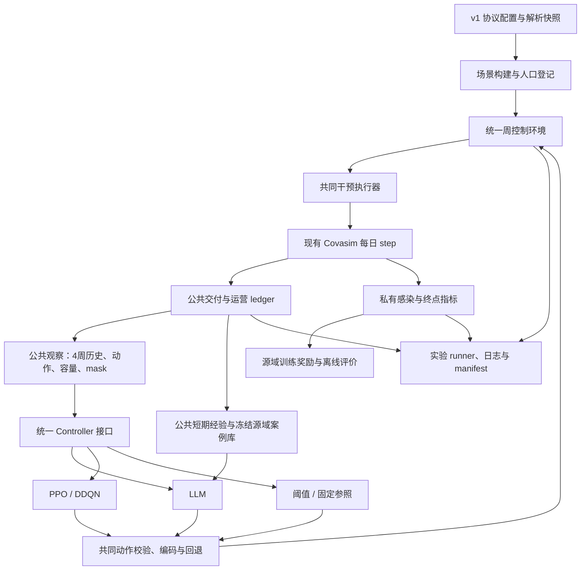

# CEMAS 推荐协议 v1 软件工程实现 Plan

本计划将[推荐实施协议](llm_recommended_protocol_v1.md)及配套[机器可读配置](control_protocol_v1.json)落实到工程接口；研究问题与设计理由保存在[归档研究方案](archive/llm_baseline_generalization_plan.md)。采用增量迁移：复用传播模拟核心，新增统一控制层，再迁移控制器、记忆和实验入口。

2026-10-14 文档整理：原确认清单的必要内容已合并到推荐协议第14节及附录 A，旧架构讨论由 Git 历史保留。本文“实测工程基线”和 D 节的 Phase 0 任务清单均为原始计划记录；Phase 0 路线中的“四份文档”指原始依据文档（基线提交 `55b12f2`），不代表当前文件清单。当前完成范围以各阶段契约及验收记录为准。

2026-10-15 P3实施补充：[Phase 3契约](control_phase3_contracts.md)记录已确认的奖励候选、共享v1人口、环境生命周期和真实E0产物门禁。所有v1实验入口统一放在 `examples/control_v1/`，旧t18及绘图保留。P3确认公式和计数语义，权重/H待后续源域验证后统一正式冻结。

本轮已确认三项实施边界：

- 以推荐 v1 为准；多角色候选、在线仿真检验和预测偏差降权留到后续版本。
- 每回合只调用一次完整 `initialize()`，保留引擎内部设置 seed 的现有规则；周间不重新初始化随机流。
- v1 对仍存活、未隔离的已康复有效通知对象执行检疫。旧测试迁移、校正，**P0–P4 行为兼容不作为新版本验收要求**。

**全阶段注意事项：文件路径可移植性**

- 数据、模型、记忆库及实验产物的路径可在代码中设置相对默认值，需要切换位置时通过参数或配置覆盖；不得硬编码某台机器的盘符、用户名或绝对目录。项目相对路径统一以项目根目录为基准，避免依赖进程启动目录。
- 运行时可以解析为绝对路径；可复用产物应记录相对路径或资源标识，不能将生成机器上的绝对路径作为后续加载的必需条件。历史绝对路径仅用于溯源，加载使用当前默认或显式配置的位置。
- 对具有数据内容/hash校验的产物，路径不参与数据身份判断；文件移动且内容/hash不变时，在其余兼容条件满足的前提下应能继续使用，同时保留内容、模型及版本校验。相关修改按需验证启动目录变化、文件迁移及内容不一致的拒绝行为。

## A. 当前代码架构理解

### 1. 现有模块及迁移判断

| 模块 | 当前职责与问题 | 实施处理 |
|---|---|---|
| [cemas/__init__.py](D:/项目/毕业设计/code/Campusim/cemas/__init__.py) | CEMAS 门面，主要重导出 Covasim 与旧 LLM/记忆类 | 增量公开新控制接口；避免导入基础包时强制加载 Gym、torch |
| [covasim/sim.py](D:/项目/毕业设计/code/Campusim/covasim/sim.py:558) | 初始化、每日推进、传播与终点计算 | 复用 `initialize/step/finalize`；不重写日步和传播算法 |
| [covasim/people.py](D:/项目/毕业设计/code/Campusim/covasim/people.py:319) | 疾病状态、检测、诊断、隔离和检疫 | 复用检测及排程能力；由 v1 执行适配层处理交付记录和处置边界 |
| [covasim/population.py](D:/项目/毕业设计/code/Campusim/covasim/population.py:112) | 校园组织、动态层、hybrid 网络生成 | 复用网络生成；小范围增加人口登记元数据，保证实际人数可导出 |
| [covasim/interventions.py](D:/项目/毕业设计/code/Campusim/covasim/interventions.py:1604) | 旧 `campus_policy_agent` 同时负责观察、LLM、记忆、护栏、执行和日志 | 不作为新控制环境底座；新执行器复用其底层工具与参数更新方式 |
| [covasim/llm_policy.py](D:/项目/毕业设计/code/Campusim/covasim/llm_policy.py:379) | P0–P4、真值状态提取、prompt、API、旧评价 | 将新协议对应职责迁入独立模块；复用必要的传输、JSONL、hash 工具 |
| [covasim/llm_memory.py](D:/项目/毕业设计/code/Campusim/covasim/llm_memory.py:129) | SQLite 双阶段写入、短期压缩、全局检索 | 复用持久化与相似度计算方式；公共 schema、特征和反馈重新实现 |
| `examples/t15_*`、`t17_*`、`t20_*`、`t21_*` | 旧实验参数、种子、套餐、CPBU 汇总 | 保留历史入口，新增 v1 主入口；不直接扩写旧实验大脚本 |
| `examples/t18_campus_calibration.py`、`t18_campus_validation.py` | 旧校准与展示 | 保留历史脚本及绘图；v1在独立目录调用统一校准模块，不复用旧多参数产物 |
| `tests/` | 引擎、校园、策略和记忆测试 | 保留适用的引擎测试；迁移控制用例，新增 v1 契约和隔离测试 |

新实现统一放在 **`cemas/control/`**。这样可以明确区分控制任务与传播引擎，避免继续增加 `campus_policy_agent` 的职责。

### 2. 必须解决的架构冲突

**公共数据来源冲突**

- `new_diagnoses` 当前可能在采样日计入未来阳性，不能代表实际交付诊断。
- 旧追踪提前设置 `known_contact`，不能代表已经通知。
- 新观察必须来自独立的交付 ledger，不能仅将旧观察中的感染字段换成诊断字段。

**控制信息冲突**

旧状态提取、记忆向量、趋势、文本和反馈包含真实感染、真实 `R_e`、传播层及未来病程信息。新控制器不能调用这些旧提取函数，也不能通过通用字典过滤来建立边界。

**动作及执行冲突**

- P0–P4 将检测、筛查、追踪和活动限制绑定，无法表达 324 个联合动作。
- 概率检测没有 v1 临床日容量。
- 旧筛查的周期分组、近期检测排除和跨路径去重不符合 v1。
- 旧套餐可能改变宿舍与 `ta`，新协议必须保持家庭类接触的政策乘数为 1。
- 旧真实感染护栏、模型自报 risk 豁免和保持期不得进入共同执行器。

**处置边界冲突**

旧引擎豁免已康复者的新检疫；死亡或延迟诊断还可能留下不应继续计负担的隔离标志。v1 执行适配层按本轮确认的规则处理，日终统计使用实际有效处置状态。

**校准、人口和实验冲突**

旧 E0 同时拟合多个层系数、使用 `R_e` 惩罚，并存在实际日数不一致；旧实验硬编码 beta、采用不同人口和初始感染、种子重叠、使用 CPBU 排名。均不能直接作为 v1 正式结果入口。

### 3. 实测工程基线

- Git 当前为 `master@b8da645`，已追踪文件无改动；四份设计文档及协议 JSON 尚未纳入 Git。
- 指定环境为 Python 3.11.14；Optuna、torch、Gymnasium、SB3、sb3_contrib、sentence_transformers 当前缺失。
- `requirements.txt` 与指定环境实装版本不同，不能视作该环境的有效 lock。
- 未发现可直接采用的 v1 校准、记忆库、训练权重或冻结 manifest。
- 导入与校园网络测试：**4 通过**。
- 策略与记忆离线测试：**26 通过、7 失败、1 跳过、1 在线测试排除**。失败主要是陈旧的套餐转换、prompt 和投票记录预期，先处理测试基线。

## B. 总体重构架构图



边界要求：

- 中央控制器只接收公共观察、公共任务定义和公共反馈。
- 执行器内部可以接触个体索引及疾病状态，以完成模拟干预。
- 私有奖励只提供给源域学习器及离线分析；不进入控制器观察、prompt 或记忆。
- LLM、PPO、DDQN、阈值和参照均通过同一个周环境、动作校验器和执行器。

## C. 分阶段 implementation plan

### Phase 0：版本基线、环境和接口准备

**目的：** 保存当前历史节点，建立可信测试基线和接口契约，使后续阶段不依赖新增训练库即可开始。

**修改文件**

- `tests/test_campus_llm_policy.py`：校正失配测试，迁移不适用于新协议的用例。
- 四份依据文档及 `docs/control_protocol_v1.json`：记录本轮确认的范围、初始化语义和康复者处置规则；不改变其他协议数值。

**新增文件**

- `cemas/control/__init__.py`
- `cemas/control/protocol.py`
- `cemas/control/types.py`
- `tools/check_control_environment.py`
- `requirements-control-v1.in`
- `requirements-control-v1.lock.txt`
- `tests/test_control_protocol.py`

**核心设计与输入输出**

```text
load_protocol(path) -> ControlProtocol
resolve_protocol(protocol, purpose, calibration_artifact) -> ResolvedProtocol
inspect_environment(python_executable) -> EnvironmentReport
```

`types.py` 定义公共、私有对象的独立类型：

- `ActionVector`、`ActionProposal`、`ActionResolution`
- `PublicPopulation`、`PublicResources`
- `PublicDailyRecord`、`PublicWeeklyRecord`
- `PublicObservation`、`PublicWeekFeedback`
- `PrivateDailyMetrics`、`PrivateWeeklyMetrics`

协议中的“本轮未修改代码/未安装依赖”等字段属于文档状态说明，不解释为未来运行配置。

**Git 路线**

1. 为 `b8da645` 创建历史 tag：`cemas-legacy-pre-v1`。
2. 创建 `feature/control-protocol-v1` 分支。
3. 精确提交四份依据文档、JSON 及其必要附件，保存协议基线；不使用 `git add .`。
4. 每阶段独立提交，记录验证结果；首个闭环验收后创建 milestone tag。
5. 不改写旧历史，不执行 force push；仓库所有权检查使用命令级 `safe.directory` 例外。

**兼容与验证**

基础 `cemas.Sim` 导入继续工作；不增加套餐转换兼容层。测试主契约逐步切换到 v1，P0–P4 只作为历史实现。

验证协议解析、配置约束、公共对象序列化边界及指定环境检查。默认测试显式排除 `online`。新增依赖在准备实际兼容安装清单后另行取得授权，安装验收完成才生成最终 lock。

---

### Phase 1：统一 action space 和公共动作语义

**依赖：** Phase 0。

**目的：** 先完成纯动作逻辑，供执行器和所有控制器共同使用。

**修改文件**

- `cemas/control/types.py`
- `cemas/control/protocol.py`

**新增文件**

- `cemas/control/actions.py`
- `tests/test_control_actions.py`

**核心接口**

```text
encode_action(vector[5]) -> action_id
decode_action(action_id) -> vector[5]
legal_action_mask(resources, population, action_spec) -> bool[324]
resolve_action(proposal, current_action, resources) -> ActionResolution
```

**行为设计**

- 顺序固定 `[T,S,C,E,A]`，档位为 `[3,4,3,3,3]`，编号公式严格采用 v1。
- 档位参数只从协议解析，避免在 LLM、RL、执行器各维护一份常量。
- 提供同一份公开动作语义、目标对象、容量单位、延迟和固定处置说明。
- RL 适配器输出普通整数编号；LLM、阈值及参照输出向量，统一进入校验路径。
- 非法请求保持当前合法动作；容量下降时仅将 S 降到最高合法档。
- `ActionResolution` 保存请求、执行向量与编号、错误、回退和调整原因。
- 每维持续时间依据实际执行动作更新，不使用单一 policy rank。

**兼容方式**

不将旧套餐映射为新联合动作；历史结果不得因为转换编号而成为 v1 数据。

**验证**

穷举 324 个动作编解码；验证三种容量分别产生 162/243/324 个合法动作；覆盖布尔、浮点、越界、非法资源、保持及 S 投影。相同公共资源下，各方法必须得到相同 mask。

---

### Phase 2：public/private observation 隔离与共同执行器

**依赖：** Phase 1。

**目的：** 建立真实交付的数据来源，并落实容量、去重、追踪和人天统计。这是信息隔离的关键阶段。

**修改文件**

- `cemas/control/types.py`
- `covasim/population.py`：仅增加必要登记元数据，不改变网络生成算法和既有返回结构。

**新增文件**

- `cemas/control/scenarios.py`
- `cemas/control/execution.py`
- `cemas/control/ledger.py`
- `cemas/control/observation.py`
- `cemas/control/metrics.py`
- `tests/test_control_execution.py`
- `tests/test_control_observation.py`
- `tests/test_control_metrics.py`

**核心类和接口**

```text
build_scenario(resolved_config, world_seed)
    -> Sim + PopulationRegistry + private_metadata

JointActionExecutor.initialize(sim)
JointActionExecutor.set_action(ActionResolution)
JointActionExecutor.apply(sim)

PublicLedgerAnalyzer.apply(sim)
PrivateMetricsAnalyzer.apply(sim)

build_observation(public_ledger, public_population,
                  current_action, resources, decision_day)
    -> PublicObservation

encode_observation(PublicObservation) -> fixed_order_float32_features
```

`build_observation()` 不接收 `Sim/People`。公共记录没有隐藏参数、个体索引、未来事件、seed 或运行标签。

**执行设计**

- 临床检测使用协议概率产生请求，按三组优先级执行，日上限 `0.02N`；超额请求当日失效。
- 筛查采用学校、非学校工作、其他三个互斥登记组；比例配额、最久未筛查优先、缺额重分。
- 两条路径统一记录实际检测，排除当天临床受检者及 `[t−3,t−1]` 实际受检者。
- 追踪只使用当日交付诊断，上限 `0.01N` 个索引病例，无欠单。
- 独立保存调查事件和待通知队列；实际交付日去重，死亡取消，降档不取消已排程通知。
- 检疫截止按有效事件的 `调查日＋14` 合并，已有检疫只延长。
- 康复接触者按本轮确认规则执行检疫；清理无效隔离残留后记录实际处置负担。
- E/A 每日按“基础层系数×当前乘数”绝对写回，避免重复叠乘；家庭层保持不变。

**人口与观察设计**

- 校园活动名单取持久 class/lab groups，不能取初始化为空的动态边。
- 实际抽取 staff 与剩余非学生分开记录，不用 `role==2` 冒充精确 staff 数量。
- 公共历史为四个完成周，最旧到最新、左侧零填充，保留有效标记。
- 严格采用 v1 的固定人口尺度、增长公式、代理比及 one-hot；mask 单独提供。
- LLM 文本和 RL 数值编码来自同一观察对象，不在目标数据上拟合归一化。

**兼容方式**

复用 `People.test()`、检疫排程、联系人查询、`get_quar_inds()` 和 runtime profile 的更新方式；不直接调用旧检测、筛查、追踪的完整 `apply()` 来冒充新规则。

**验证**

重点覆盖交付延迟、同日检测去重、两检测容量、筛查日期边界、通知合并与取消、康复者检疫、死亡隔离清理、家庭层保护、活动权重和 Q 并集。

固定公共记录后改变感染真值、beta、传播日志或未来队列，观察及其编码必须完全一致。

---

### Phase 3：Gym-style 周环境、固定参照与 E0 校准

**依赖：** Phase 2。该阶段形成第一个可运行功能里程碑，具体交付接口和实际证据以[Phase 3契约](control_phase3_contracts.md)为准。

**修改文件**

- `cemas/control/protocol.py`、`types.py`、`scenarios.py`、`__init__.py`：静态验证、PublicInfo、共享人口参数构造及导出。
- 已有 `rewards.py`、`controllers.py`、`logging.py`：扩充具体奖励、两个固定参照和日志，不覆盖原有接口。
- 协议JSON、推荐协议、P0奖励说明、工程计划及阅读索引；新增P3契约。

**新增文件**

- `cemas/control/environment.py`、`runner.py`、`calibration.py`。
- `examples/control_v1/smoke.py`、`calibrate.py`、`evaluate_calibration.py`、`run_references.py`。
- 环境、奖励、日志/runner和校准测试；补充协议、场景及集成测试。

v1后续入口也位于 `examples/control_v1/`；可复用逻辑放在 `cemas/control/`。旧t18及绘图保留，不创建t23，不在薄入口重复实现校准或环境逻辑。

**环境接口**

```text
WeeklyControlEnvironment(protocol, mode='evaluation', purpose='smoke', scenario_options=None)
reset(seed, options) -> (PublicObservation, PublicInfo)
step(action_id) -> (PublicObservation, reward, terminated, truncated, PublicInfo)
step_proposal(proposal, fallback_reason=None) -> 同一返回
action_masks() -> bool[324]
audit_snapshot() -> EpisodeAuditSnapshot
close()
```

先实现不依赖Gymnasium的同形接口；Phase 6增加薄适配器。动作编号经共同decoder转为提案，两入口共用唯一resolve/执行主线。环境推进、独立奖励计算、控制器决策和logger写记录分别负责，runner仅编排单回合。

- 训练模式向学习器返回真实reward；评估返回 `0.0`，真实值通过私有审计写日志，两模式不改变世界轨迹。
- Controller只接收公共观察和反馈。PublicInfo仅含resolution/feedback，reset时为空。
- 真值、reward、beta、seed、未来事件、完整DecisionRecord和simulator不得进入控制器、prompt或memory。
- `audit_snapshot()`仅供runner，返回不可变记录和配置，不返回simulator或可变runtime对象。

**时序与奖励**

- reset新建已经初始化的ScenarioBundle，使用实际挂接executor/analyzer，不再次initialize，周间不设seed。
- day0先决策，历史为空；每步直接调用最多七次sim.step，保留原引擎日内顺序；公共/私有量使用相同已完成闭区间。
- H112为112个日步、n_days111、16次决策；尾段按实际日数结算，不放大，不进入完整周观察历史，通过反馈和日志交付。
- 到H自然terminated，不bootstrap、不额外推进、不提前交付pending事件。环境独立保存进度和finalize_attempted，完整回合只尝试finalize一次，close幂等。
- 未完成关闭或reset记aborted，日步/finalize等基础设施异常记failed，不伪装为完整结果。
- `V1RewardCalculator`保留RewardCalculator.compute签名，RewardBreakdown同一分项供奖励/日志使用。统一I/N及T/.12NH、L/.10NH、Q/NH、A/NH，λ=1/四项各.25；N/H回合固定，不含初始感染，不裁剪，无切换/终点额外奖励。
- P3记录cemas-reward-v1/development_candidate，后续源域及H验证后统一冻结。主敏感性λ=.5/1/2，内部扰动作为扩展，不能按最终测试或某方法优势选权重。
- 最低参照 `[0,0,0,0,0]`，最高 `[2,Smax,2,2,2]`；Smax从公共mask取得，两者经过共同执行器。最低仍有例行基线。

**E0 校准接口**

```text
resolve_campus_parameters(protocol, world_seed, beta=..., ...) -> 独立参数容器
make_calibration_sim(protocol, beta, world_seed, window='primary', data=...) -> 已初始化Sim
fit_beta(protocol, reconstructed_data, window='primary'|'exploratory') -> CalibrationArtifact
evaluate_beta(artifact, evaluation_seeds=None) -> FitReport
save_calibration_artifact(artifact, output_dir) -> artifact.json
save_fit_report(report, output_dir) -> fit_report.json
load_calibration_artifact(path, protocol, require_evaluation=True) -> CalibrationArtifact
```

E0与后续校园控制共用协议engine的完整v1人口生成配置，包括N12000/初始感染30、三段年龄比例.60/.20/.20、全部校园参数和固定网络/病程。提取纯参数构造函数，两路径容器独立、用途seed分离。E0安装test_num延迟0，控制环境安装共同执行器延迟1，各自只初始化一次。

仅拟合beta∈[.005,.04]，固定层系数，100 trials、优化器seed84001、每候选三个固定世界。损失先逐世界计算日诊断MSE再平均，除以(观测均值+1)²；不使用平均曲线MSE，不加累计诊断或R_e惩罚。主窗16实际日/n_days15，独立20世界；辅助拟合12实际日/n_days11，独立留出从拟合起点连续推进，仅评价最后4日。

保存beta、trial/失败、数据hash、完整解析配置及人口统计、种子、依赖/代码版本、独立误差和运行带。真实主窗artifact及匹配fit_report均核验后才允许科学环境；拒绝裸beta、旧人口/四参数文件、缺失或损坏证据。人口/基础模型用于兼容核验，完整协议hash用于追溯；控制H或奖励变化本身不要求重校准。

数据只支持重建聚合诊断序列拟合与计数核查；daily tests为重建输入，不称官方原始逐日数据验证。E0核验与目标正式冻结分开：候选目标可做校准后源域开发，最终测试仍须后续完整冻结。

**兼容与验证**

已有每日模拟调用继续使用；新入口不调用旧campus_policy_agent，不重构传播核心。日志从首个闭环启用，保存公共日/周、DecisionRecord、私有日/周奖励、summary/manifest和失败；只有finalize、对账和落盘成功才登记completed。

实施顺序：契约/静态验证→奖励/共享参数→周环境→参照/日志/runner→小人口验收和完整smoke→E0/独立评价→加载E0的参照运行。使用指定simulation Python，先通过相关离线测试，再以N12000/H112、smoke世界、beta.016运行两个参照，明确标记smoke且calibration_verified=false，核对：

```text
cum_infections = initial_infections + sum(daily_new_infections) <= N
各成本日量之和 = 周量之和 = 终点汇总
-sum(真实周reward) = 终点positive_cost
```

逐项核对两检测路径、通知、处置并集和三活动；累计量不逐周相加，峰值取max，终点状态取末值。覆盖H7/8/10/15、day0/reset/close/finalize、pending、同世界前缀重放、训练/评估轨迹一致、公共边界和失败记录。真实主/辅助窗拟合及独立评价成功后登记实际证据，不预填beta/通过数。两个参照不能替代后续全部主方法的H门禁。

---

### Phase 4：LLM controller 重构

**依赖：** Phase 3；先实现无显式经验记忆版本。

**修改文件**

- `cemas/control/controllers.py`
- `cemas/__init__.py`

**新增文件**

- `cemas/control/llm.py`
- `tests/test_control_llm.py`

**统一控制器接口**

```text
Controller.reset()
Controller.decide(PublicObservation) -> ActionProposal | None
Controller.observe(PublicWeekFeedback)
```

公共任务、动作语义和目标在构造时注入；不注入 `Sim`、私有日志或实验 manifest。

**核心实现**

- `LLMController`：`llm_no_explicit_memory` 单控制器；observation 是唯一历史来源，observe 只校验类型。
- `build_public_messages()`：仅两条 system/user 消息，公共配置由 runner 白名单投影；固定模板为 `cemas/control/prompts/public_v1.json`，不传完整协议或私有元数据。P4 拒绝非空 memory_context。
- `parse_action_response()`：仅接受 `action/reason`；五个普通整数，reason 非空、单行、≤120 字，拒绝额外字段。
- `LLMTransport`：独立供应商参数适配及可注入 mock client。
- 最多三次总尝试、固定 2/4 秒间隔、SDK 内部重试关闭、timeout120秒；仅临时服务及解析失败复用原 prompt 重试。配置/鉴权/余额/硬配额/未知异常立即终止。
- 输入保护上限131072 token，完整消息使用对应模型的官方本地 tokenizer/消息模板；固定文件hash、库版本、请求模式及模型对应关系。缺少资源或供应商计数验收则阻止真实 episode。输出总量保护上限65536，包含推理和最终回答；DeepSeek使用max_tokens，Qwen使用max_completion_tokens，不单设thinking_budget。上限用于阻止异常膨胀，结构体积依据及尚待实测的部分见P4契约第7节；P4 不裁剪、不压缩。
- runner-owned `llm_calls.jsonl` 保存各次请求/返回型号、完整消息、三类hash、计数器身份、输入计数、usage、响应、耗时和脱敏错误。fatal 也先落盘，不推进当前周；超限零调用，实际 usage 不符终止。
- 耗尽返回 `None + llm_retry_exhausted`，runner 交共同 resolver；DecisionRecord 记录调用次数及是否成功。离线只用smoke池，真实开发只用prompt_development池并保留真实E0门禁。

模型参数沿用 v1。真实服务是否接受请求、实际返回版本和 token 计数方式通过源域 API 验收取得，不能提前宣称成功。

**兼容方式**

新 parser、prompt 和控制器独立于旧套餐接口；不保留 `risk` 的执行豁免。旧文件只提供必要的通用工具复用。

**验证**

使用 mock 验证 schema、精确重试/等待次数、供应商参数、完整输入预算、审计持久化和共同回退；检查私有变化及observe不影响prompt。真实provider/tokenizer验收覆盖day0、完整四周及长数值消息，单独进行，不进入默认单元测试。最终接口、命令及实际证据见 [P4 契约](control_phase4_contracts.md)。

---

### Phase 5：公共记忆、案例检索与决策依据

**2026-10-17计划修订：** 按本轮用户要求，Phase 5优先采用[本次研究架构](llm_architecture_research/02_recommended_architecture.md)。具体实施范围、接口、文件、分步退出条件和验收见[Phase 5实施计划](control_phase5_implementation_plan.md)。本节已按独立 [Phase 5 契约](control_phase5_contracts.md) 完成离线实现和工程验收；真实 provider/tokenizer、正式案例库和控制效果仍不在本阶段完成标准内。

**依赖：** Phase 4公共LLM基础链；离线工程可先完成。真实LLM运行仍依赖官方tokenizer/provider及兼容E0验收；最终27世界×4策略源库另依赖Phase 6的阈值调优和统一H/目标确认。

**推荐实现**

- 单个无会话状态的`MemoryLLMController`，每周重建system/user两消息；复用P4唯一的transport、计数、重试和审计链。
- 确定性公共近期摘要、实际执行案例及revision；`stage(PublicObservation)`后用`accept(PublicWeekFeedback)`配对，实际动作不由提案推测。
- 独立公共SQLite schema、源域构建器和只读store；来源seed/策略/私有评价另存，目标经验不追加全局库。
- 数值检索采用研究38维state＋最近3完整周的原始差分trend，权重`.75/.25`；top_k≤6、同动作≤2，并落实资源/动作适配、同源/同内容去重、冲突对与OOD处理。
- 本阶段不实现embedding、旧三路混合相似度或LLM反思。原memory节中的相关参数是被本次P5 profile取代的历史候选，P5不得隐式读取并混用。
- 保留六条核心规则，增加版本化知识卡；四模式none/short/global/both保留相同基础观察、知识、模型及新输出schema。
- 新wire为`action/reason/evidence_ids/alternative_actions/uncertainty_codes`，适配回原`ActionProposal`；保留旧P4两字段模板/parser/入口作为兼容基线。
- 完整消息超硬预算时依次裁整案例（冲突对成组）、低优先级外部卡、附加recent；每轮重建引用与flags；不裁基础四周、mask、任务规则与核心六条。
- 新增runner-owned依据日志，先持久化调用和依据再推进；反馈包含尾窗，不额外推进或提前交付事件。保持现有共同resolver和失败分类。

**配置与文件边界**

新增独立`docs/control_memory_v1.json`及严格加载器作为P5算法配置；现有协议继续提供共同任务和模型设置，旧两字段LLM配置保持兼容。新增memory_types/memory/memory_store/retrieval/knowledge/llm_memory及版本资源；修改LLM接入点、controllers、runner和logging限于P5必要集成。具体清单见独立实施计划，不修改共同观察、动作、执行、奖励或传播内核。

**采集与阶段依赖**

P5实现`tools/collect_observable_memory.py`的公共采集、构建、覆盖审计和冻结能力；用人工数据、最低/最高合法/独立RNG随机合法三个简单策略的smoke验收。仅增加严格源池`memory_collection`用途，内部走scientific环境并保留E0门禁。

Phase 6实现/调优阈值后，使用同一工具采集27世界×4策略=108轨迹，H/目标改变时统一重采集/重冻结。P5的fixture/development只读库不得标为evaluation_ready。P5不提前实现阈值、RL、H/权重选择、E1–E4调度或完整统计。

**验收**

覆盖公共/私有扰动不变性、实际动作配对、末周/截短后窗、幂等/reset、revision/只读完整性、38维与排序边界、知识和四模式一致性、五字段引用校验、裁剪后注册表、审计故障与共同回退，以及P4回归。真实provider验收入口在P5准备，实际付费调用与最终科学建库单独登记门禁；离线通过不表示控制收益或真实运行已获验证。

---

### Phase 6：PPO、DDQN、阈值及源域开发

**依赖：** Phase 3 的环境和真实校准产物；LLM/记忆模块按 Phase 4–5 接入源域验证。

**修改文件**

- `cemas/control/controllers.py`
- `cemas/control/environment.py`
- `requirements-control-v1.in`、lock

**新增文件**

- `cemas/control/rl/ppo.py`
- `cemas/control/rl/ddqn.py`
- `cemas/control/training.py`
- `cemas/control/worker.py`
- `tests/test_control_rl.py`
- `tests/test_control_training.py`

**核心接口**

```text
GymControlEnv -> Gymnasium observation/action/step interface
PPOController.predict(public_features, legal_mask) -> action_id
DDQNController.predict(public_features, legal_mask) -> action_id
ThresholdController.decide(public_observation) -> ActionProposal
train_controller(source_config, train_seed) -> checkpoint_records
select_checkpoint(validation_A, validation_B) -> FrozenControllerArtifact
```

**实施顺序**

1. 安装并锁定验收后的依赖。
2. 实现并调优公共阈值控制器。
3. 使用P5工具采集并冻结development源域案例库，供全方法源域开发使用；此时不标记evaluation_ready。
4. 实现 MaskablePPO 和真正的 Double DQN。
5. 全方法源域验证、预算/H 门槛检查及冻结；条件确定且完整27×4来源证据通过后发布evaluation_ready案例库，H/目标改变时统一重采集。

**算法要求**

- PPO 使用协议网络与超参数，mask 在环境内实现；训练和评估使用 mask-aware 路径。
- DDQN 在线网选择合法 argmax，目标网取该动作值；探索、贪心和 bootstrap 均 mask，replay 保存 next mask。
- 两算法均使用公共数值观察、324 动作和相同私有目标，gamma1。
- 阈值采用 v1 指标、边界、迟滞及 32→4→1 的源域筛选。
- 控制器使用本地 RNG；RL 仿真使用独立进程隔离世界随机流。先验证一个环境，不同时推进多世界。
- 三个训练 seed 全部保留；按 A/B 选择 checkpoint，不选最好训练 seed 代表算法。

**预算与 H**

执行四回合 pilot，记录首次 JIT、稳态模拟和训练耗时。按 v1 的预算阶梯和源域曲线决定是否升级，记录实际仿真量。

H 若从112延长，统一更新全部方法的时域和尺度，重新开发、选参及采集记忆，然后冻结；最终测试不得触发这些调整。

**兼容与验证**

采用延迟导入，基础仿真不因 RL 依赖缺失而失效。先用合成网络输出测试 Double 更新和非法最大 Q，再做短训练验证；覆盖终点不 bootstrap、mask 一致、checkpoint 选择、随机流隔离和池间不交叉。

---

### Phase 7：完整实验入口、冻结、日志与统计

**依赖：** 全方法源域开发和首个闭环验证完成。日志骨架已有，本阶段扩大实验编排能力。

**修改文件**

- `examples/control_v1/` 中按用途命名的实验薄入口
- `cemas/control/logging.py`
- `cemas/control/scenarios.py`

**新增文件**

- `cemas/control/experiments.py`
- `cemas/control/statistics.py`
- `tests/test_control_experiments.py`
- `tests/test_control_replay.py`
- `tests/test_control_statistics.py`

**入口与数据接口**

```text
run_experiment(protocol, purpose, experiment, method, frozen_artifacts)
    -> run_manifests

run_episode(resolved_run, controller) -> RunResult
validate_freeze(artifacts, purpose) -> validation_report
replay_prefix(prefix_record, resolved_world) -> verified_state
summarize_paired_results(run_manifests) -> tables_and_intervals
```

每个运行目录输出：

- `public_daily.csv`
- `private_daily.csv`
- `decisions.jsonl`
- `private_weekly_rewards.csv`
- `summary.json`
- `manifest.json`
- 失败记录

manifest 保存完整解析引擎参数、版本/hash、用途、seed、配对关系以及校准、模型、prompt、记忆、embedding、checkpoint 版本；不传给控制器。

**实验实施**

- E1/E2：全部开发项冻结后运行；E2 复用 E1 中等条件的完整/无记忆轨迹，只新增两分支。
- E3：生成协议年龄分布的 hybrid `popdict`，通过实际 `Sim(people=popdict)` 接口使用；学校/工作名单与网络生成条件一致，验证筛查和活动映射。
- E4：day0–27共同最低干预，day28接管；高保持在28变高，待解锁在42/56变高。
- E4 同方法分叉前复用一次决策响应、检索和实际动作，通过世界重放核对疾病、网络、交付队列、公共历史及控制器状态；不依赖 `deepcopy(sim)` 自动保存全局随机流。
- lambda 补充及第二模型开发配置在首次读取可复用最终测试结果前冻结。
- 正常 LLM 失败保留回退轨迹；基础设施失败保留 attempt，按同身份同版本重放，不覆盖原记录。

**统计与验收**

按 world 块保持配对，再重采样 RL 训练 seed；bootstrap10000、seed83001。报告原始指标、区间和预定配对差，不使用 CPBU 排名，不把复用轨迹或时间点当独立样本。

验证冻结门禁、seed 池、重复身份保护、失败保留、E4 前缀一致、未来日期无泄漏、复用不增加样本量及日周终点对账。

## D. 第一阶段具体执行任务列表

**本节为最初的Phase 0历史任务清单，不是当前待办。首个功能交付里程碑为Phase 0–3：一个校园条件、两个固定参照、统一观察/动作/周环境和完整对账日志；当前交付及验收状态查各阶段契约。**

Phase 0 按以下顺序执行：

1. **保存 Git 历史节点**  
   核对状态，创建 legacy tag 和功能分支，精确提交依据文档及协议配置。

2. **登记本轮已确认规则**  
   写明 v1 范围、一次完整初始化语义、康复者检疫及旧套餐兼容边界。

3. **处理现有测试基线**  
   逐项校正七个陈旧预期；可复用的执行与日志用例保留，套餐专属用例不作为 v1 契约。

4. **建立依赖检查工具**  
   使用指定 Python，输出必要包版本、缺失依赖和 CPU 环境，不读取或输出凭据。

5. **建立 `cemas/control/` 包骨架**  
   仅引入基础依赖，确认普通 `cemas` 导入不加载训练库。

6. **实现协议加载与解析**  
   检查动作结构、N/H、缩放、资源、参考尺度和 seed 范围；smoke 与正式用途明确区分。

7. **定义公共及私有类型**  
   禁止公共对象携带 simulator、真值、未来队列及运行元数据。

8. **冻结公共序列化契约**  
   明确字段顺序、单位、有效标记和 schema 版本，为后续 LLM/RL 同源编码提供依据。

9. **增加 Phase 0 验证**  
   协议解析、用途门禁、公共字段边界、基础导入及迁移后的离线测试全部运行；默认排除在线测试。

10. **提交阶段成果并记录下一门槛**  
    保存环境报告、测试结果与 Phase 0 commit。随后进入 Phase 1 动作编解码和 mask；不在此阶段安装依赖、调用模型、训练或改动传播核心。

beta 校准结果、最终 H/预算、实际依赖版本、服务返回型号和 embedding revision 均由后续实际验收产生。它们是必须生成并冻结的工程产物，不以设计值冒充完成结果。
