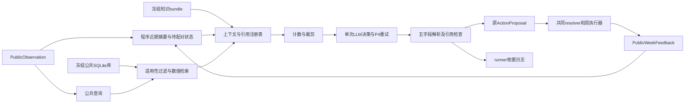

# CEMAS v1 Phase 5 实施计划：公共记忆、案例检索与决策依据

日期：2026-10-17。状态：**已按本计划实现；离线工程验收完成，真实 provider/tokenizer 验收待执行**。实现与证据见 [Phase 5 契约](control_phase5_contracts.md)。

## 1. 阶段目标与依据优先级

Phase 5 的目标是：在已有公共观察—LLM提案—共同执行—公共反馈闭环中，加入可核查的近期经验、冻结源域案例和知识引用，使控制器能够比较当前情景与过去的实际执行记录，并给出结构化决策依据。

采用本次研究的明确主方案：**一个无会话状态的决策LLM，配合确定性公共记忆、固定尺度数值检索、冻结知识卡和程序检查。** 每周通常一次模型调用；反馈处理、摘要、案例形成、检索、知识选择与引用检查不调用LLM。

依据优先级：本轮用户指定的阶段范围与研究优先原则 → [推荐架构](llm_architecture_research/02_recommended_architecture.md)、[提示词](llm_architecture_research/05_prompts_and_examples.md)、[知识设计](llm_architecture_research/04_knowledge_and_sessions.md) → 本计划对工程接入细节的明确化 → 原v1计划未冲突部分。共同观察、动作、时序、奖励和信息隔离继续遵守现行协议；研究中的替代实验不因此成为本阶段功能要求。

本计划落实研究路线中的R1–R3及建库工具；R4只准备可独立执行的真实验收入口。R5以后的正式源域开发、方法比较和目标实验分别交给Phase 6/7。

### 1.1 当前实现基线

本轮静态核对：`feature/control-protocol-v1@2950e7f72355f03fda2bb69559378a06a9ca5eba`。开始时已有未跟踪的`docs/llm_architecture_research/`，是上一轮交付，应完整保留。

- P4已有`LLMController`、两消息prompt、两字段parser、tokenizer/provider门禁、唯一重试循环、共享回退及私有调用审计。
- P4的`build_public_messages()`仍拒绝非空memory；P5通过独立`MemoryLLMController`、公共记忆/检索/只读案例库和五字段wire接入，旧P4入口保持兼容；正式27×4案例库仍未生产。
- runner已在终止判断前交付公共反馈，包含最后不足7日的窗口；无需修改执行器或增加`on_resolution()`。
- runner现支持独立RNG的合法随机采集策略、typed公共transition sink和窄用途`memory_collection`；最终策略与正式源库仍受Phase 6门禁。
- 最新P4契约记载572 passed/1 failed为历史结果，后期原始验收目录当前不可得；真实provider/tokenizer未验收，旧E0产物需要按当前源码重新生成并验收。本轮没有重跑这些测试。

实现必须使用`E:/pytroch/anaconda3/envs/simulation/python.exe`。具体已安装依赖、官方资源和产物身份在实现开始时重新检查，不沿用历史环境路径或测试数字。

## 2. Phase 5 做到哪里

| 本阶段必须交付 | 完成标准 |
|---|---|
| 公共类型、近期摘要与案例状态机 | 精确公共输入；实际动作配对；完整/尾窗、幂等、reset、失败可验证 |
| 源域案例存储、构建与只读加载 | 独立公共schema；来源私有映射分离；事务revision；manifest和兼容校验 |
| 数值检索、适用性、冲突与多样性 | 研究的38维state、差分trend、固定排序/过滤；空结果和失败有明确语义 |
| 冻结知识bundle及选择 | 六条核心规则＋已研究的三条外部警示；来源和使用限制可追踪 |
| 新LLM控制器的四种记忆模式 | none/short/global/both同模型、同system、同知识、同输出schema |
| 五字段响应、引用检查与依据日志 | 转回原ActionProposal；执行前落盘；执行后关联实际动作；不回传私有审计 |
| 完整预算控制 | 官方计数覆盖两消息；只裁附加资料；同字节重试；保留P4失败分类 |
| 采集/构建工具和工程测试 | 人工案例、三个简单策略的离线smoke验证工具链；明确fixture/development状态 |
| 真实服务验收入口与门禁 | 能验四模式及边界消息；缺真实验收时阻止真实P5运行；不伪造accepted凭证 |

明确排除：阈值控制器实现/调优、PPO/DDQN、训练与checkpoint选择、H/目标权重选择、E0算法修改或完整重标定、最终27×4采集任务的执行、E1–E4正式编排/统计、城市及资源事件环境、E4世界分叉重放、embedding及对照方法、多智能体/审查LLM/反思/世界模型、服务端会话和缓存管理器。

这些排除项不是缺失的P5实现。正式108条源轨迹的生产依赖Phase 6；P5必须先把生产所需工具做好，不能等待最终数据才开始写记忆模块，也不能用测试样例库冒充正式库。

## 3. 原v1计划与研究方案的替换表

| 原P5安排 | 本阶段采用的安排 | 影响 |
|---|---|---|
| `begin(observation, executed_action)` | `stage(observation)`后由`accept(feedback)`读取实际执行动作 | 当前decide时未知实际执行动作；不从提案或私有DecisionRecord猜测 |
| state/trend/text三路，权重`.4/4⁄15/1⁄3` | state/trend数值检索，权重`.75/.25` | embedding不安装、不下载、不实现；旧混合检索只是后续对照 |
| 固定模型revision、本地embedding hash | 冻结feature版本、尺度、检索配置及案例hash | 无向量可用性依赖；不建立空embedding适配层 |
| 一个ObservableMemoryStore兼顾写入和检索 | 公共CaseBuilder＋只读FrozenPublicCaseStore＋纯Retriever | 写权限与运行时检索连接隔离；不会把来源私有索引交给控制器 |
| 单窗公共后效 | 一次实际执行首窗＋可选下一已闭合窗的revision | 明确后续动作和截短状态；不声称14日后效具有因果性 |
| 裁案例后“压缩短期总结” | 依序裁案例/低优先级外部卡/附加摘要；不做LLM摘要 | 保留原始四周O、mask、任务规则及六条核心 |
| 仅P4两字段决策 | 新版本五字段wire，并保留旧P4入口 | 新四模式共用新wire；原parser不放宽 |
| 固定六条专家规则 | 保留六条并加类型化来源卡与解释性警示 | 现实建议不映射动作阈值；无记忆组得到相同知识 |
| 案例ID日志占位 | 完整DecisionEvidence、最终发送/引用案例及检查状态 | 外部可核查；不将引用存在率称为推理忠实性 |
| P5最终建库 | P5交付采集/冻结能力；P6阈值就绪后生产完整库 | 不提前实现阈值/RL；H变化后按同工具重采集 |

保留：公共/私有隔离、324动作、7日周期、共同resolver、四周公共观察、四种记忆消融、top_k上限6、同动作最多2例、源/验证/测试划分、目标案例不写全局库、每回合清短期。

## 4. 预期闭环与模块分工



同一决策的顺序固定：校验O与回合状态 → 暂存O → 用O计算近期指标与query → 选择知识/案例 → 建registry与required flags → 官方计数/必要裁剪并重建registry → 固定最终消息和hash → P4调用/重试 → 解析/导出依据 → runner可靠落盘 → 共同执行 → 公共feedback闭合案例 → 尾窗照常交付后结束。

### 4.1 推荐文件划分

以下是本阶段实际实现清单；最终正式源库和效果实验仍不属于本阶段。

| 文件 | 职责 |
|---|---|
| `cemas/control/memory_types.py`（新） | 不可变公共类型：RecentSummary、本地case revision、PublicCase、CaseQuery、RetrievalResult、KnowledgeCard、PublicMemoryContext、解析结果及公共依据 |
| `cemas/control/memory.py`（新） | PublicEpisodeMemory、纯近期摘要、case描述模板、P5配置加载/校验；不连接环境或服务 |
| `cemas/control/memory_store.py`（新） | 源case构建、revision事务、冻结/完整性检查、只读store、安全opaque group索引；私有来源文件由runner/采集层独立管理 |
| `cemas/control/retrieval.py`（新） | 查询特征、有效性、距离、硬过滤、冲突对和确定性多样性选择 |
| `cemas/control/knowledge.py`（新） | bundle验证、版本/冲突/触发选择；不用在线检索或模型生成知识 |
| `cemas/control/llm_memory.py`（新） | MemoryLLMController、P5消息组装/裁剪、五字段parser和引用注册表；组合确定性模块并复用P4调用链 |
| `cemas/control/llm.py`（改） | 仅抽出必要消息准备/响应解析接入点，保留单份transport/tokenizer/retry/audit实现 |
| `cemas/control/controllers.py`（改） | 增加默认空的依据导出方法；增加独立RNG的UniformLegalController用于采集smoke |
| `cemas/control/runner.py`、`logging.py`（改） | 新工厂、P5依据落盘、公共采集sink、窄用途与seed检查、来源私有登记、live验收门禁 |
| `cemas/control/prompts/public_memory_v1.json`、`cemas/control/knowledge/public_knowledge_v1.json`（新） | 研究模板与九条知识卡的正式资源，独立版本/hash |
| `docs/control_memory_v1.json`（新） | P5算法配置，显式取代原memory候选配置，不改共同任务参数 |
| `tools/collect_observable_memory.py`（新） | 采集/构建/覆盖/冻结薄入口，可重放已导出的公共输入，不包含第二套模拟循环 |
| `examples/control_v1/smoke_memory.py`、`run_memory_llm.py`、`accept_memory_llm.py`（新） | 离线工程演示、受门禁保护的真实prompt开发、独立P5服务验收 |
| `tests/test_control_memory*.py`、`test_control_retrieval.py`、`test_control_knowledge.py`、`test_control_llm_memory.py`（新） | 按边界分组测试；必要用例扩展现有runner/logging/LLM测试 |
| `docs/control_phase5_contracts.md`（实施时新增） | 实现接口、可复现命令、当次真实验收结果和未通过门禁；不提前写通过 |

`control/__init__.py`和`cemas/__init__.py`仅在确需公开新入口时调整，保持延迟依赖导入。共同`types.py`、observation、actions、resolution、execution、environment、rewards、calibration默认不改；发现必须改共同契约的需求，应先说明具体原因，不能借P5顺手扩展任务。

## 5. 工程设计中必须固定的细节

### 5.1 配置与兼容性

采用独立、严格校验的P5配置文件，避免把旧P4的`json_fields=[action,reason]`改成五字段导致旧接口失效。原`control_protocol_v1.json`继续提供动作、目标、时域、模型/重试/预算、seed池等共同参数；新增`control_memory_v1.json`提供新prompt/知识资源、模式及检索/裁剪参数。P5工厂显式加载两者，**绝不再读取旧`protocol.memory`里的embedding/混合相似度作为隐式fallback**。

P5配置记录`schema_version, architecture_version, response_schema_version, template_path, knowledge_path, short_term_window, trend_window, retrieval, budget_policy`。所有路径相对项目根解析，可显式覆盖；数据库路径与官方资源路径来自入口参数，不硬编码机器盘符。完整配置hash进入runner私有manifest；文件移动不改变内容身份。

两类hash分开：

- `public_task_sha256`取当前白名单`public_spec`的任务语义投影、公共schema版本、当前O.execution_days；明确排除`objective.status`这一纯冻结登记状态，完整保留动作、观察、目标公式/数值和时间规则，不包含template/reason限制、seed、beta、资源未来事件或私有目标值。H不同拒绝复用case，当前容量不同走适配过滤；人口结构允许由公共特征比较。
- 仅把objective.status由development_candidate改成frozen不使P5任务hash变化；冻结状态在私有manifest单列，不能据此跳过数值和H兼容校验。template/public_spec/messages沿用P4审计口径；另记P5 profile、knowledge、case-store和context hash。研究样例中的简化`public_task_snapshot.json`只作设计示例，不能直接冒充生产`PublicPromptConfig`的完整白名单。

基于真实引擎/E0的兼容性由runner在打开源库前检查私有构建manifest；controller只拿已验证的公共store。不能只凭公共任务hash宣称疾病模型、校准或采集身份相容。

### 5.2 公共记忆状态机与时序

接口固定为：

```text
PublicEpisodeMemory.reset() -> None
PublicEpisodeMemory.stage(PublicObservation) -> None
PublicEpisodeMemory.accept(PublicWeekFeedback) -> tuple[LocalCaseRevision, ...]
PublicEpisodeMemory.recent(PublicObservation) -> RecentSummary
```

`LocalCaseRevision`只含公共事实、本回合序号和revision，不声明来源是正式source_simulation；源域构建器通过用途/seed检查后将本地序号映射成全库case_id，再构造PublicCase。这个来源标记是发布权限，不能由控制器自报。staging为新case事务分配单调正整数ID，冻结保留ID；来源映射保存在私有登记中，目标本地ID不进入源库。

- `stage`只保存一个待配对O；同day同hash可幂等，不能重复生成case；同day不同hash或未闭合就进入新day为fatal。
- `accept`要求start=已暂存decision_day、end=min(start+6,H-1)，使用feedback.week实际动作/资源，核对此前公共周与O最近周一致。请求动作不作为case事实。
- 首窗成为closed_one；下一相邻公共反馈生成closed_two新revision，同时保留下一动作/资源是否变化。每case只需等待一个后窗；旧revision保留审计，检索只读冻结manifest指定的最新有效revision。
- 到H的首窗标terminal_censored；不足7日首窗有partial_window；缺失或不足7日后窗有truncated_followup。closed_two不等于14个完整日；不补未来交付、不追加H日决策。
- 相同反馈重复为幂等；重复但内容不同、乱序、窗口不匹配停止。decide fatal未推进不生成case；可重试耗尽后共同回退实际执行，仍可由反馈生成描述性case。
- reset清pending、本回合序号、去重表及等待后窗状态；不修改global库。短期prompt只由本次O的四个有效完整周生成，不从本地缓存扩成第五周。

本地revision无私有reward、成功/失败标签、隐藏感染估计或LLM自由总结。临时运行失败的轨迹保留诊断记录，但不进入可发布的源案例集。

### 5.3 存储、审核与冻结

开发时采用SQLite标准库；不用新数据库服务。写入与只读运行对象分开：

```text
PublicCaseBuilder.append(local_revisions, private_source_registration) -> stored_ids
PublicCaseBuilder.finalize(source_run_status) -> CollectionReport
freeze_public_store(staging, private_manifest, output_dir, purpose) -> StoreManifest
FrozenPublicCaseStore.open(path, verified_manifest) -> read_only_store
```

第一接口的私有登记由采集/runner端持有和处理，不向PublicEpisodeMemory、PublicCase或Retriever传递；builder对外返回仅公共ID。实现上公共case写连接与来源sidecar写连接必须分离。

冻结库表限定为：`case_revisions(case_id,revision,payload_json,public_content_sha256)`、`active_revision(case_id,revision)`、`case_group(case_id,opaque_group)`及公共版本metadata。opaque_group只用于同轨迹去重，无seed/策略编码，不在检索返回或prompt中展示。真实世界/策略/E0/源码/split存独立私有manifest，禁止ATTACH到运行时SQLite连接。

冻结要求：来源run已正常完成；schema/字段/数值/时间与公共hash通过；覆盖统计完整；每case恰有一个active revision；写事务结束、checkpoint并关闭写连接后生成稳定DB文件和hash。失败不覆盖旧文件。发布目录不能与输入库同路径；`mode=ro`启动且执行写入负例验收。

manifest分别记录`purpose=fixture|development|evaluation_ready`与`storage_state=immutable`。P5可冻结fixture/development库验证只读性；evaluation_ready必须核对30001–30027每个指定world与四策略的笛卡尔积恰有108条完整且唯一轨迹、九组合映射正确，以及Phase 6提供的兼容阈值/H/目标冻结证据；仅四种策略名称出现或轨迹总数够均不合格，当前证据缺失就拒绝发布。不可把“只读”与“正式实验数据已合格”混称。runner只允许fixture库用于smoke或独立provider消息探针，真实prompt开发只接受来源已审核的development/evaluation_ready库并保留E0门禁；P5仍不开放最终测试运行。

全部有效公共结果均可保留，包括诊断增加、高负担与矛盾案例；不得按私有成本挑好案例。去重hash排除case_id/revision/随机group等标识，只覆盖公共语义内容；不按文字句式删反例。完整性/版本/缺文件是fatal，运行中发现库hash变化停止批次。

### 5.4 检索算法及开发默认值

直接落实研究02章§6.2，不另选embedding：

| 项目 | P5实现值 |
|---|---|
| 状态 | 38维：最近周10项、当前三容量、剩余时域、三人口角色比例、五年龄比例、16动作one-hot；固定次序/尺度及valid mask |
| 趋势 | 最近3完整周的五公共率一阶差，最多2×5；保存原始差分，仅在RMS中归一化一次 |
| 缺失 | 双方有效交集计算；state交集/并集有效维≥.75；trend缺失时权重归一到state；不填缺失为稳定 |
| 相似度 | exp(-RMS)，state/trend权重.75/.25；RMS≤3且score≥.35；不裁数值 |
| 容量适配 | 当前query与case首窗临床/筛查/追踪容量比差≤.01/.03/.005；任一超限排除；实际case动作必须满足当前mask |
| 其它硬过滤 | schema/公共任务一致、合格source、首窗7日；day0只比day0，有历史排除无历史 |
| 排序与去重 | 前24按score降序/ID升序；top_k≤6，同action≤2，同opaque轨迹≤1，同公共内容≤1；贪心冗余罚.10 |
| 冲突对 | 相同执行动作、案例间state_sim≥.8，各自诊断变化符号相反且绝对值≥5；先选最小query_score最大的一对，tie用ID；先锁冲突对，再补不同action |
| 剩余并列 | 贪心目标同分按原score降序、case_id升序；冲突对内部按score降序/ID升序展示 |

首周/零目标人群、常量趋势、相同比例但不同实际人数、恰好门槛边界必须可确定重放。无历史的增长等维度无效；38维检索不是RL的198维编码，不修改RL观察。

`empty`表示结构过滤后无样本；`out_of_support`表示有结构候选但距离不达门槛；`unavailable`只用于已明确分类的暂时查询IO错误。无样本不自动hold、不自动强干预；模型继续利用公共O与知识。SQLite损坏、schema变化、未知异常不是可恢复IO错误。

所有阈值仅是研究确定的开发默认。本阶段实现/测试确定性，不用验证或测试结果调参；是否提升控制效果在Phase 6/7检验。全库规模约千级案例时用确定性扫描即可，不引入近似向量索引。

### 5.5 知识与四模式的一致性

固定SIM-01..06核心，PH-01=CDC、PH-02=UKHSA、PH-03=WHO。迁入正式资源前核对ID、来源路径、日期/版本、公共字段映射、limits和hash；研究卡片的reviewed只证明研究时核读，不可伪造人类签字或效果认证。

核心规则永远存在于system；外部卡仅作user资料。启动时拒绝缺核心、非法字段、重复ID、未知版本、candidate/excluded等非reviewed卡和未解决的conflict_pairs；conflict_group只是主题。相互矛盾的**案例**可共存，未解决的**知识规则冲突**不能混进发布bundle。

主profile只允许知识trigger依赖O的always/has_history/testing_changed/capacity_changed；暂不启用依赖检索case_conflict的知识卡，确保四模式知识相同。testing_changed以相邻有效完整周实际检测量相对差>.25计算，只是测量提醒。现实医院/疫苗指标不存在就不移植其操作阈值。

| 模式 | 原始公共四周 | 附加recent | 全局检索 | P5 wire/system/知识 |
|---|---|---|---|---|
| none | 保留 | null | 不打开库，empty＋disabled | 相同 |
| short | 保留 | 程序生成 | 不打开库，empty＋disabled | 相同 |
| global | 保留 | null | 只读源库 | 相同 |
| both | 保留 | 程序生成 | 只读源库 | 相同 |

上表承诺同O的初始知识选择相同。按研究顺序进行预算裁剪后若知识不同，必须记录最终knowledge IDs/hash及裁剪原因；该决策不得宣称严格等知识消融。P5验收覆盖这一边界，后续正式比较应通过预先容量验收避免该差异，或保留全部轨迹并单列分析，不能事后丢弃不利轨迹。

可在所有模式内部计算O派生flags，但none/global不得把recent正文暗塞入消息。旧P4的两字段无显式记忆控制器作为单独legacy基线；不能拿它直接与P5 both比较就归因于记忆。P5的`method=llm_public_memory_v1`、`memory_mode`与`response_schema_version`明确登记，`controller_type`仍为llm。

### 5.6 复用P4调用链与新输出

保持`LLMController`默认build/parse行为和`build_public_messages(memory_context!=None)`的拒绝语义。新控制器组合memory/store/retrieval；在P4中只抽取必要的protected消息准备/响应解析接入点，使两者使用同一服务调用、usage校验、重试和审计路径，不复制decide中的网络循环。

消息准备返回不可变`PreparedDecision`：最终messages、消息hash、本地input_tokens、裁剪后的registry/required flags、最终knowledge IDs/hash、context/资源版本及待写公共依据。模型只看到消息，不能看到完整PreparedDecision中的运行审计信息。P4默认路径仍构造两键user和旧两字段parser；新路径按研究五键user格式构建完整两消息。

新wire恰含action、reason、evidence_ids、alternative_actions、uncertainty_codes。全部长度、枚举、普通整数、重复键/NaN拒绝规则按研究05章；备选去重且不同于主动作。引用必须存在于最终发送注册表，O引用无效历史或无效数值不允许；R只在recent实际发送时可用，K/C只引用本次已发送卡/例。引用值由程序从输入提取，不让LLM重新生成。

程序required flags在最终裁剪后计算：始终partial_observability；O无历史为no_history；O检测/资源变化照实标记；启用global且最终无案例为no_case；保留冲突对才case_conflict；距离门槛失败为out_of_support；已发送案例后窗缺失/不足7日为truncated_followup。不增加knowledge_conflict等未定义wire枚举。

主动作仅格式/范围校验，资源非法继续交共同resolver；备选mask非法只记录infeasible，既不执行也不因此重试主提案。`ActionProposal`字段不变，reason仍≤120字符。模型没有结构错误但理由不充分属于待评估的决策质量，不能在线读取私有结果重选。

### 5.7 预算、失败与审计

当前输入131072/完整输出65536、最多3attempt、2/4秒等待、timeout120、SDK retry0均从现有LLMSettings读取。≤16384只是软体积目标，不新增硬限制或为追软目标随意删资料。

超硬预算时：删最低排序案例（冲突对成组）→删低优先级PH卡→移除附加recent → 核心仍超限则零调用fatal。每次删后重建registry/flags并重新计数；最终请求固定后重试绝不重新检索、重新计数、补assistant历史或换资料。

错误处理沿P4：结构/引用错误视ActionResponseError，同消息重试；耗尽None＋llm_retry_exhausted；鉴权/计数/资源身份/完整性错误立即停止。查询暂时失败只降为当周无案例，不伪称disabled；下一周重查。调用前失败保留已知hash和错误，不生成假的attempt。

Controller新增默认空`drain_decision_evidence()`；P5成功/耗尽都导出程序上下文状态，只有成功才填模型理由/引用。runner依次可靠写现有llm_calls与`decision_evidence.jsonl`的prepared事件后才执行；执行后追加resolved事件或通过`(decision_day, observation_hash, context_hash)`关联decisions.jsonl，保持append-only。日志中区分selected_case_ids、cited_case_ids、dropped_case_ids；DecisionRecord.retrieved_case_ids记实际发送的ID，不只记引用的ID。

若fatal与审计错误同时发生，保留主异常和脱敏次级错误；依据落盘失败不推进当前周。公共feedback/case日志写入失败发生在已执行之后，应保留已完成窗口、将run标failed、不继续下一周；不能伪装回滚或重执行该窗。语义审阅状态默认not_reviewed，程序检查不写成忠实性证明。

## 6. 采集工具与Phase 6依赖拆分

### 6.1 P5工具能力

新增`memory_collection` runner用途，只允许协议30001–30027源池；最终测试及A/B、prompt开发池拒绝写入正式source。该用途映射到环境scientific，保留校准产物和人口兼容检查，拒绝裸beta。真实LLM仍只允许prompt_development，不顺手开放LLM scientific或最终测试。

工具支持两条入口：

1. 从已审核公共观察/反馈导出构建staging。导出要有私有manifest证明用途、完整run和来源hash，公共数组本身不能自证来源；人工输入只产生fixture。
2. 调现有runner采集minimum、maximum_feasible、uniform_legal_independent_rng。随机策略对当前mask合法ID均匀采样，使用自身Generator，reset可重复；不读/重置世界随机流。种子由采集编排层私有记录，控制器只持有策略本地RNG，不接收世界seed。

runner仅新增typed公共transition sink：参数为当前PublicObservation和PublicWeekFeedback，不含奖励/resolution/完整snapshot；每窗调用且包含terminal。sink内部复用同一个PublicEpisodeMemory/CaseBuilder算法。controller正常observe仍保持原职责，禁止复制一套案例构造逻辑。该sink可空，旧P4与参照入口行为不变。

源世界映射按协议九组合×三重复，beta尺度外层、容量中层、重复内层：`i=seed-30001; beta_index=i//9; capacity_index=(i//3)%3; replicate=i%3`；尺度/容量数组来自协议。beta及映射标签只归runner私有配置，不能进入case/query。

采集工具不实现tuned_threshold；P6实现并选定阈值后，将第四策略通过相同runner公共导出构建器接入。P5测试缺第四策略时evaluation_ready冻结必须拒绝，不能以最低策略替补。

### 6.2 P5实际验收与P6实际生产

P5默认做人工case构建、三个简单策略的小规模离线smoke与fake transport四模式闭环；smoke身份使用90001/90002，构建库标fixture、不可进入正式source。它们不等于27×3的正式采集任务。

P6负责调优阈值后生产27×4=108完整轨迹，检查各维/组合/转移/资源/时间/测量变化覆盖，按world分组留出；源域允许development只读库供选择，但全部主方法/H/权重确定前不宣布evaluation_ready。H或目标变化按统一规则重采集/重冻结，不只改LLM。

P5提供覆盖报告算法和按opaque group排除同轨迹的测试；不执行完整leave-world-out效果研究、不统计策略优劣、不用私有reward筛样本。

## 7. 真实服务验收单独列账

P5工程验收无需付费调用；真实运行仍必须通过P4官方tokenizer资源/请求参数/服务身份验收，另有`memory_prompt_acceptance.json`证明新prompt、五字段解析和四模式消息适用。保留P4三case receipt的版本与验证逻辑，不强改旧格式。

独立P5验收至少覆盖：day0 none、四周short、四周global、四周both（含冲突）、zero-case/out_of_support、长数值/高案例数消息。记录最终消息/hash、本地与provider计数、响应字段/引用、usage、模型/指纹与P5profile/知识/schema版本。官方资源、服务身份、template/schema变化后需重新验收。加载补充receipt时必须验证上述实际profile/template/bundle/schema内容hash、官方计数资源身份、请求参数、返回服务身份及必需case覆盖；仅文件存在或版本名一致不足以放行。补充receipt不是疾病实验，不推进仿真。

用人工但合法公共输入进行服务验收可标明fixture；不能将其中案例写进正式库。正常P5 live工厂要求两类receipt及真实E0；只要缺一项就不启动真实episode。P5实现这套门禁和mock测试；是否实际调用API、准备资源及重建E0需后续明确授权，本轮不执行。

## 8. 分步实施与退出条件

| 步骤 | 工作 | 本步退出条件 |
|---|---|---|
| P5.1 契约与配置 | 新公共类型、profile与资源版本；明确旧/新wire、hash和数据权限 | schema负例、配置冲突、来源无效和旧P4默认兼容测试通过 |
| P5.2 生命周期与摘要 | stage/accept/reset、窗口校验、revision、纯O摘要、尾段 | 正常、回退执行、重复、乱序、fatal、H110尾窗均可对账 |
| P5.3 知识与只读库 | 九卡资源、触发/冲突、builder/SQLite/freeze、私有来源分离 | 来源/ID/版本正确；无私有字段；写入阻断；fixture不冒充正式库 |
| P5.4 数值检索 | 38维/差分、适配门槛、冲突优先、贪心多样性与IO失败 | 小型人工库有可独立手算的排序/过滤/边界测试，结果稳定 |
| P5.5 新控制器 | 独立两消息、四模式、五字段parser、registry、预算裁剪 | 同O四模式控制变量一致；无网络重试外额外调用；旧两字段基线仍通过 |
| P5.6 runner与审计 | 新工厂、typed公共sink、prepared/resolved依据事件、终点反馈 | 审计先于执行；复合故障保留；实际动作与请求分离；耗尽走共享回退 |
| P5.7 工具与用途 | 三简单策略smoke、源池检查、采集/覆盖/冻结入口 | 正确映射源池；最终池拒绝；缺第四策略不能evaluation_ready；不执行正式27×4 |
| P5.8 门禁与总验收 | 新prompt真实验收入口/mock；目标回归、离线闭环和契约 | 下节工程门槛通过，真实门禁状态单列，最终diff无阶段外改动 |

P5.2和知识卡校验可以并行；SQLite先完成才做检索，控制器需等待确定性的上下文契约，runner集成后才做完整smoke。不要为并行开发复制prompt算术、case模板或重试循环。

## 9. 验收清单与报告格式

研究V01–V27中的**P5对应工程性质**转成真实测试；E4世界分叉、正式统计、模型语义忠实性与效用属于后续实验，不能以fixture通过宣称已验证。

| 组 | 必须验收的性质 | 研究对应 |
|---|---|---|
| A 权限 | 精确公共类型；含私有字段/对象拒绝；只改私有输入时公共context、query、消息不变；错误日志不泄密 | V01/V02/V10 |
| B 生命周期 | 四周validity、零检测、proxy>1、实际动作、durations、幂等、重置、末周/短后窗、失败无伪case | V03–V09 |
| C 存储/检索 | 只读、版本/hash、revision唯一、稳定排序、同源去重、冲突对整体裁剪、38维尺度和精确边界 | V11–V14/V26/V27 |
| D 知识/模式 | 九卡ID映射、六核心始终保留、知识冲突阻止加载、四模式同知识同system、none/short无库也能运行 | V22/V24 |
| E LLM/预算 | 五字段严格解析、有效引用、required flags、三次同消息、长度截断、超预算零调用、真实计数门禁 | V15–V19 |
| F 集成 | 依据/调用先落盘、fatal不推进、反馈写失败不继续、shared resolver、非法备选只标注、末周交付 | V20/V23/V25 |
| G 工具 | smoke库只作fixture、源池映射/RNG隔离、完整库缺策略拒绝、路径迁移hash不变、旧P4入口不回归 | P5新增必需 |

测试顺序：纯类型/生命周期/知识/检索 → P5 prompt/parser/controller的fake transport → runner/日志失败集成 → 三简单策略和四模式离线smoke → 全部相关`test_control_*`及导入/校园人口回归。新增行为必须有测试；不为文档修改写业务测试，不复制实现公式充当唯一oracle，至少保留手算边界和私有扰动反例。

实现时使用指定解释器和已有本地pytest路径；环境缺依赖要分别登记“未测/环境阻塞”，不得删用例制造全绿。未提供正式tokenizer时可注入fake counter测试裁剪/重试控制流，但不把fake数字称为模型token。真实资源库的合成词表测试仍不代替provider验收。

Phase 5工程完成必须同时满足：四模式离线完整闭环；公共边界与终点验收；确定性案例/检索/知识；P4兼容回归；完整依据日志；采集/冻结工具；新的live门禁；Phase5契约记录真实命令/结果/失败；diff仅包含P5必要文件。

最终报告分别填写：

1. `phase5_offline_engineering`：实际通过/未通过、命令、测试数及证据目录。
2. `phase5_live_acceptance`：未执行/通过/失败；不得以1代替2。
3. `source_case_library`：fixture/development/evaluation_ready，以及策略/世界/版本覆盖。
4. `control_effectiveness`：本阶段未验证，后续Phase6/7负责。

## 10. 本轮计划交付与后续接口

本轮已完成本计划划定的 Phase 5 离线实现、入口和工程验收；保留研究文档、现有协议和 P4 兼容入口。没有安装依赖、调用付费 API、运行正式科学仿真、提交或推送。真实 provider/tokenizer 验收、正式 27×4 源库和控制效果仍由后续门禁管理。

后续实施者可直接按P5.1–P5.8推进。若缺真实E0或provider资源，继续完成不依赖它们的工程和离线验收，并保留真实运行门禁；若缺Phase6阈值，交付可用建库工具和缺策略拒绝证据。不能因这些依赖尚未完成而提前扩展Phase6/7，也不能把研究目录中的人工数据当作阶段实现完成。
