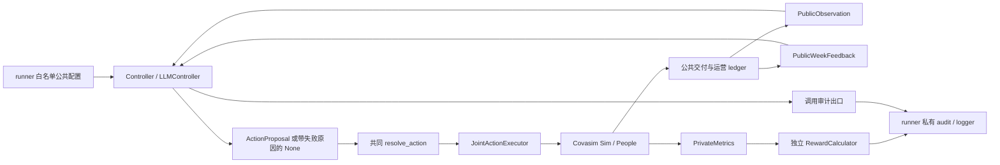
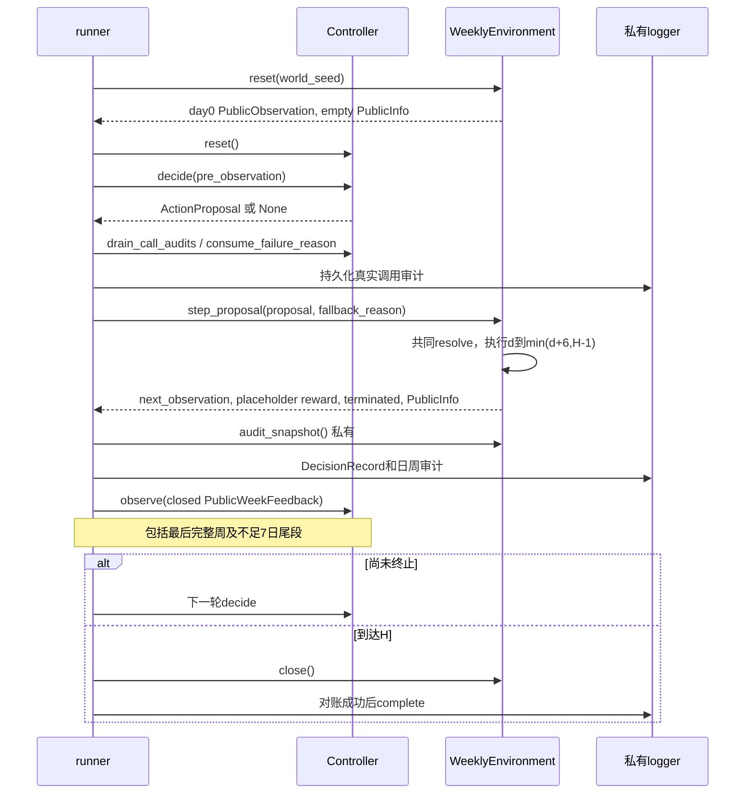

# Campusim/CEMAS v1：当前实现与架构设计基线

核查日期：2026-10-17（用户时区 America/Los_Angeles）。本文件是本轮 LLM 架构研究的项目事实基线，不是新的运行验收报告。

当前代码已实现公共观察、共同动作与执行、周环境、私有评价、两个固定参照及无显式记忆 LLM 的离线调用链。公共记忆、完整案例采集、阈值调优、RL 和最终实验尚未实现。研究方案可以重新设计 LLM 内部，但必须明确说明对下列已实现契约及既有 P5 计划的任何替代。

## 1. 核查范围、证据等级与版本

- 工作目录：`E:/项目/毕业设计/code`。
- 分支：`feature/control-protocol-v1`。
- 基线 HEAD：`2950e7f72355f03fda2bb69559378a06a9ca5eba`，提交说明 `fix(control): align P4 configuration and failure audits`。
- 初次核查及本文件写入前，`git status --short --branch` 均显示工作区干净；这不是对研究文档完成后的工作区状态作保证。
- 读取起点为 [CEMAS_READING_INDEX.md](../CEMAS_READING_INDEX.md)，随后读取总计划、推荐协议、JSON、P0–P4 契约，以及本文件涉及的源码和测试。
- 本轮未运行单元测试、仿真、训练、模型 API 或依赖安装。测试文件的存在与断言内容只能证明已有验收设计，不能证明今天执行通过。

本文件使用三类证据标签：**代码事实**指在上述 HEAD 的源码、配置或测试中直接核实；**历史登记**指阶段契约报告过的运行结果；**设计计划**指现行文档或 JSON 中尚未实现的配置和接口。架构研究提出的新选择应另外标为设计决策或待验证假设。

文中 `文件:Lx–Ly` 是上述 HEAD 的行号，后续实现可能移动；相邻链接用于打开文件。优先级为：真实实现确定当前行为，协议和阶段契约确定约定；发生不一致时应公开记录，不用历史摘要覆盖当前代码。

主要一手项目文档：

| 文档 | 当前职责 |
|---|---|
| [阅读索引](../CEMAS_READING_INDEX.md) | 入口、分阶段状态和继续开发边界 |
| [工程实现计划](../cemas_v1_implementation_plan.md) | P0–P7 计划及 P4/P5 分工 |
| [推荐协议](../llm_recommended_protocol_v1.md) | 任务、信息、训练/验证/测试及实验规则 |
| [协议 JSON](../control_protocol_v1.json) | 已加载参数与后续阶段推荐配置的机器来源 |
| [P0 契约](../control_phase0_contracts.md) / [P1 契约](../control_phase1_contracts.md) | 类型、公共序列化、动作空间、mask |
| [P2 契约](../control_phase2_contracts.md) | 执行器、公共 ledger、观察与私有指标 |
| [P3 契约](../control_phase3_contracts.md) | 周环境、共同目标、生命周期、E0 与历史验收 |
| [P4 契约](../control_phase4_contracts.md) | LLM 调用链、真实服务门禁、后续修正与历史验收 |

## 2. 当前阶段状态和不能沿用的旧结论

| 阶段 | 当前可核实状态 | 限制 |
|---|---|---|
| P0 | 不可变公共/私有 schema、抽象接口、公共 hash、DecisionRecord、协议加载验证已存在 | P0 契约中的原环境路径和验收数字是历史记录 |
| P1 | 五维 324 动作编解码、筛查容量 mask、ActionResolution 已实现 | mask 不代表全部运行时请求都能满足 |
| P2 | campus 场景、共同执行器、公共 ledger、198 维编码、私有感染指标已实现 | 当前场景构造仅支持 campus |
| P3 | 周环境、奖励、固定参照、runner/logger、E0 接口与兼容门禁已实现 | 科学有效性、权重/H正式冻结及最终实验没有由闭环验收证明 |
| P4 | 无显式记忆 LLM、公共 prompt、严格 parser、transport、计数验收门禁、重试与调用审计已实现 | 官方 tokenizer/provider 验收仍待完成；不能宣称真实 episode 已可运行 |
| P5 | JSON 和文档中有公共 memory 计划 | tracked files 中没有 `cemas/control/memory.py`、`tools/collect_observable_memory.py`、`tests/test_control_memory.py` |
| P6/P7 | 训练、调优、冻结和实验协议已有计划 | 当前 runner 不支持完整方法集合；计划参数不等于已经训练或实验 |

下列时间顺序对后续实施有直接影响：

1. P3 契约登记过 334 项通过、完整 smoke、主/辅助 E0 和独立评价，见 `control_phase3_contracts.md:L158–185`。这些是历史登记，不是今天重跑。主窗 beta 贴近原搜索上界，辅助留出误差存在；契约只支持重建聚合诊断序列拟合及流程核查，不证明真实世界预测能力。
2. 原 P4 契约登记 472 项回归通过和离线完整闭环，明确未做真实 API 验收，见 `control_phase4_contracts.md:L66–86`。
3. 随后的活动预算、年龄说明和复合审计故障修正，改变了人口登记/标定源码 hash。契约明确旧 E0 产物预期被拒绝，后续科学运行须重新生成并验收 E0，见 `control_phase4_contracts.md:L107–111`。不能只引用 P3 历史通过就跳过当前 E0 门禁。
4. 后续预算修订把输入保护上限改为 **131072**，完整输出保护上限改为 **65536**；不再单设 Qwen 推理预算。最新契约登记 **572 passed、1 failed**，失败是当时 D 盘环境缺少 `tokenizers`，见 `control_phase4_contracts.md:L113–130`。不能把原 472 通过写成当前源码的全量验收。
5. 本机 `results/` 一级目录仅发现 `control_v1_phase1`、`control_v1_phase2`、`control_v1_phase4`。契约引用的 `results/phase4_fixes_20261016/`、`results/llm_budget_review_20261016/` 和 P3 目录在本次 checkout 不存在；尝试读取对应日志、体积测量和兼容报告失败。因此这些结果保留为契约历史登记，当前未取得原始产物进行独立复核。

项目当前指定 Python 是 `E:/pytroch/anaconda3/envs/simulation/python.exe`。契约中 D 盘或旧 Python 版本只代表相应历史验收环境，本文件没有据此修改环境。

## 3. 已实现模块与权限图



图中私有分支没有指回 controller、prompt 或 memory 的边。执行器可以读取个体状态完成干预；这不授权控制器读取同一状态。公共日志的“公共”表示字段口径，不表示把整个文件交给控制器。

| 模块/主要符号 | 职责和关键位置 |
|---|---|
| [types.py](../../cemas/control/types.py) | 固定公共/私有 dataclass；`PublicObservation` L300–362，`PublicWeekFeedback` L365–379，`PublicInfo` L382–393 |
| [controllers.py](../../cemas/control/controllers.py) | `Controller` L12–33；`MinimumController` L44–59；`MaximumFeasibleController` L62–76 |
| [actions.py](../../cemas/control/actions.py) | `encode_action`、`decode_action`、`ACTION_TABLE`、`legal_action_mask`，L14–63 |
| [resolution.py](../../cemas/control/resolution.py) | `resolve_action` L10–45，唯一共同选择合法动作/回退逻辑 |
| [scenarios.py](../../cemas/control/scenarios.py) | `PopulationRegistry` L20–35；`build_population_registry` L51–88；`build_scenario` L183–257 |
| [execution.py](../../cemas/control/execution.py) | `JointActionExecutor` L70–367，日请求、交付、活动限制和私有分配审计 |
| [ledger.py](../../cemas/control/ledger.py) | `PublicLedger` L16–108，连续日记录、完整周历史和尾段反馈 |
| [observation.py](../../cemas/control/observation.py) | `build_observation` L50–76；`encode_observation` L110–139 |
| [environment.py](../../cemas/control/environment.py) | `WeeklyControlEnvironment` L78–359；公共 transition 与私有 `audit_snapshot` 分开 |
| [rewards.py](../../cemas/control/rewards.py) | `V1RewardCalculator`、`RewardBreakdown`，私有 reward 与公共实际负担相结合 |
| [llm.py](../../cemas/control/llm.py) | 公共配置 L82–155；消息构造 L258–266；parser L282–304；控制器 L637–738 |
| [runner.py](../../cemas/control/runner.py) | 公共配置投影 L54–79；独立计数验收 L104–202；`run_episode` L261–399 |
| [logging.py](../../cemas/control/logging.py) | 公共序列化/hash L70–81；`DecisionRecord` L84–140；`RunLogger` L158–334 |
| [public_v1.json](../../cemas/control/prompts/public_v1.json) | 当前完整系统提示词及六条固定规则，L3–4 |

## 4. 精确公共数据契约

所有核心数据对象为 frozen/slots dataclass，嵌套对象做精确类型检查；窗口端点均包含。任意扩展字典不能冒充公共对象。见 `types.py:L18–61` 和 [P0 契约](../control_phase0_contracts.md):L22–41。

| 对象 | 当前字段 | 单位与约束 |
|---|---|---|
| `ActionVector` | `values` | `[T,S,C,E,A]`，普通整数，长度5，范围分别0–2/0–3/0–2/0–2/0–2 |
| `ActionProposal` | `action`, `reasoning` | explanation 可选，若有则非空单行≤120字符；不是私有分析记录 |
| `PublicPopulation` | `population`, `age_band_counts`, `school_population`, `work_population`, `school_work_population` | 固定登记人数；年龄段0–16/17–23/24–30/31–60/61–99，年龄向下取整 |
| `PublicResources` | `clinical_daily_capacity`, `screening_daily_capacity`, `tracing_daily_index_capacity` | 当前日容量；C容量计索引病例调查数，不是通知人数 |
| `PublicCost` | `clinical_tests`, `screening_tests`, `delivered_notifications` | 实际执行/交付人次，可跨日重复 |
| `PublicCost` | `isolation_person_days`, `quarantine_person_days`, `union_person_days` | 日终人数累计的人天；并集消除同日重叠 |
| `PublicCost` | `school_restriction_person_days`, `work_restriction_person_days`, `community_restriction_person_days` | 固定名义活动预算乘限制比例的人天 |
| `PublicWeeklyRecord` | `start_day`, `end_day`, `delivered_diagnoses`, `cost`, `executed_action`, `resources`, `growth`, `growth_valid`, `diagnosis_test_proxy`, `proxy_valid` | 已封闭1–7日窗口；观察history只接受完整7日窗口 |
| `PublicObservation` | `decision_day`, `execution_days`, `initial_infections`, `population`, `resources`, `current_action`, `action_duration_days`, `legal_action_mask`, `history`, `week_valid`, `previous_day_known_isolated`, `previous_day_known_quarantined`, `previous_day_known_union` | 当前任务常量/公共上下文和最近四个已完成周；mask恰324位 |
| `PublicWeekFeedback` | `week`, `previous_week` | 本次封闭窗口与可选前周；可交付不足7日终点尾段 |
| `PublicInfo` | `resolution`, `feedback` | reset时二者为空；不含reward、seed、sim或private metrics |

对应代码为 `types.py:L64–94,159–227,259–393`。

### 4.1 观察构造与派生量

`build_observation(public_ledger, public_population, current_action, resources, decision_day, *, execution_days, initial_infections, action_duration_days, legal_action_mask)` 不接受 `Sim`/`People`，只使用截至决策日前一日完成的公共记录，见 `observation.py:L50–76`。

- 历史以day0锚定：0–6、7–13、14–20等，最多最近四周，最旧到最新，左侧零填充并设置 `week_valid=false`。无效整周不是疫情稳定的证据。
- `growth = log2((D_current+1)/(D_previous+1))`；只有当前为完整周且有前一完整周时有效，否则值0且标记false。
- `diagnosis_test_proxy = 本窗口已交付诊断 / 本窗口实际检测人次`；分母为0时值0且无效。由于采样与交付时点错位，该值可能大于1，不能当严格同批样本阳性率，也不能裁剪为1。
- `action_duration_days`逐维倒数连续实际执行日数；不同维度可能有不同持续时间。
- `encode_observation()`输出版本 `cemas-public-observation-float32-v1` 的198维float32，mask独立提供；使用固定N/H/7N或目标人数归一化，不在目标数据上拟合尺度、不裁剪。

证据：`ledger.py:L45–108`；`observation.py:L91–139`；测试 `test_control_observation.py:L105–126,149–217`。

### 4.2 当前明确不可用的信息

控制器、公共memory和prompt不能获得：当前隐藏感染、个体病程、真实R_e、传播链/层传播真值、beta、seed、未来资源排程、pending诊断/通知、个体索引、完整protocol/manifest、`DecisionRecord`、`WindowAudit`、`EpisodeAuditSnapshot`和真实reward。

`initial_infections`是已经明确公开的初始总数例外，不是当前感染真值，也不是已交付诊断。公共目标公式和权重可以公开，实际感染项和实际reward仍私有。当前公开实际检测/通知量和容量可以计算利用率；**临床/筛查/追踪请求数及unmet工作量不是公共字段**，不能在新记忆中写成已知未满足需求。其私有位置为 `execution.py:L36–54,324–328`。

私有指标定义见 `types.py:L396–432`；runner审计包含这些指标及pending数量，见 `environment.py:L49–75,333–347`。训练环境可以向学习器返回reward，但这不允许把reward作为后续策略输入；评估返回0.0，真实值写入私有日志。见 `environment.py:L272–273`及 [P3 契约](../control_phase3_contracts.md):L70–74。

## 5. 动作语义与共同执行：不能由LLM重新定义

编码为 `action_id = 108T + 27S + 9C + 3E + A`，范围0–323，动作表不随资源或控制器改变。所有0档均表示相对于固定运行基线“不增加对应干预”，因此T0/C0仍有例行检测/追踪；隔离检疫是共同处置，不是第六动作。见 [P1 契约](../control_phase1_contracts.md):L5–81。

| 维度 | 已实现有效设置 | 关键限制 |
|---|---|---|
| T | T0/T1/T2症状日检测概率.08/.14/.22；检疫入口检测另有明确概率 | 概率产生请求，实际执行受临床日容量约束；不是固定检测人数 |
| S | 日请求量 `ceil(ratio*N)`，ratio=0/.02/.05/.10 | 只有此维被决策阶段mask筛选；使用固定登记N |
| C | 分家庭/学校/工作/社区的覆盖概率与通知延迟 | 索引病例调查容量由外部资源规定；提高C不会增加容量 |
| E | 学校传播乘数1/.5/0；名义限制比例0/.5/1 | 只作用学校课堂层，不表示全人口居家 |
| A | 工作/社区传播乘数1/.75/.5；名义限制比例0/.25/.5 | 不直接作用课堂或家庭/宿舍 |

完整数字以 [协议 JSON](../control_protocol_v1.json) `actions` 为准，而非在新代码中另存默认值；上表仅为阅读提示。T/C继承legacy参数、S/E/A为v1合成设计，这些不是已校准现实政策效果，见 [P1 契约](../control_phase1_contracts.md):L15–55。

### 5.1 mask与回退

`legal_action_mask()`只检查S请求量是否不超过当前筛查容量。N12000时，容量0/240/600/1200允许81/162/243/324个联合动作。T/C每日容量、实际合格人数属于执行约束。无共同最低保持期、升降幅度限制、迟滞、切换惩罚或隐藏感染护栏。

`resolve_action()`行为是：合法提案直接执行；非法S提案或缺失输出回退到**当前整个动作组合**；若当前S因容量下降也非法，才仅将当前S降到最高合法档，T/C/E/A保留。它不是把非法请求的S裁低后执行请求的其他四维。请求、执行、调整和回退原因分别保留。见 `resolution.py:L27–45`及测试 `test_control_resolution.py:L18–56`。

### 5.2 实际执行及负担

- 临床容量默认.02N/日，追踪容量默认.01N个索引病例/日；请求超额不结转。报告延迟1天，检测敏感度.95，失访0。
- S按学校、非学校工作、其他三互斥登记组分配，优先最久未筛查者；排除已知确诊、当天临床受检及此前3日任一路径实际受检者，缺额再分配。
- C只调查当天实际交付诊断；通知同日同人去重，跨日重复另计；降档不取消已排程通知，死亡取消交付。检疫到有效调查日+14，并只延长已有检疫。
- E作用`clu/clg`，A作用`of/cm`，家庭/宿舍`d/ta`不变。每天按基础层系数×当前乘数绝对写回，不能重复叠乘。
- 活动负担使用reset登记名册和固定个人时间预算；单学校/工作者对应活动.8、社区.2，双重身份学校/工作各.4、社区.2，其他人口社区1。不能由隐藏感染或实际网络边反推负担。

证据：`control_protocol_v1.json:L445–481,531–544`；`scenarios.py:L51–88`；`execution.py:L169–302,331–367`。

当前`build_scenario()`仅支持campus，资源参数是静态`screening_capacity_ratio`。executor允许决策日开始前`set_resources()`，但当前环境没有实现E4完整资源事件排程接口；E3城市/E4事件编排仍需后续实现。见 `scenarios.py:L183–228`、`environment.py:L85–89`、`execution.py:L129–148`。

## 6. 一次决策、反馈与终点的真实生命周期



证据：`runner.py:L304–367`；`environment.py:L237–273`。

day0先决策，再推进第0天；每步最多7个真实日步。到H不再决策/推进，也不提前交付pending事件。最后不足7天的窗口按实际天数结算，不补齐或放大；公共反馈和日志交付尾段，观察仍只含完整周。`finalize`在完整回合仅尝试一次；失败不重试成成功；close幂等，未完成关闭记aborted。

**记忆接入的关键事实：** 当前Controller没有`on_resolution()`，runner只传reset、公共观察和公共反馈。`PublicWeekFeedback.week`已经包含实际执行动作、资源、窗口和负担；因此兼容的方案可以在`decide()`暂存公共决策前观察，在`observe()`将其与实际执行及公共反馈配对后创建完成案例。必须使用`feedback.week.executed_action`，不能用模型请求替代实际执行。尾段反馈在runner检查terminated之前交付，因此无需额外推进环境才能封闭最后案例。

P5计划中的`EpisodeMemory.begin(public_observation, executed_action)`尚未实现。后续方案若保留此签名，必须明确何时获得实际动作；可在反馈到达时完成配对，或显式设计只传公共resolution的新增回调。不能暗中让memory读取runner私有audit。

异常窗口不制造完整案例：如果决策fatal，环境不推进；若环境或日志失败，运行保留失败证据。新memory组件须明确pending清理/不可检索状态与reset行为，不能在缺反馈时填入推测后效。

## 7. 当前LLM请求、解析和服务门禁

当前`LLMController.method = llm_no_explicit_memory`。`build_public_messages()`每轮重建恰好两条消息：system为固定模板加白名单公共任务规则；user为规范JSON，恰含`observation`和程序计算的`public_rates`。任何非None `memory_context`都抛出`NotImplementedError`。`observe()`只检查类型，无历史缓存；transport无会话状态。见 `llm.py:L258–266,455–456,637–657`。

公共配置来自`runner.make_public_prompt_config()`的嵌套白名单，不把整个protocol传入LLM。公开有效动作设置、共同目标和处置规则不等于允许读取当前真实beta、疾病状态或manifest。`PublicPromptConfig`不可变，内容hash可追溯，见 `runner.py:L54–79`、`llm.py:L82–155`。

当前最终响应必须恰含`action`和`reason`：五个普通整数，reason非空单行≤120字符。拒绝重复JSON键、额外字段、布尔/浮点、越界、Markdown或“修复过的JSON”；parser不查资源mask，资源校验留给共同resolver。见 `llm.py:L269–304`。

当前调用配置事实，见 `control_protocol_v1.json:L806–840`：

| 项 | 当前值/行为 |
|---|---|
| 主/次模型配置 | `deepseek-flash` / `qwen3.5-plus-2026-02-15`；实际可用型号、版本和服务能力仍须外部核实与账户验收 |
| 请求方式 | OpenAI兼容chat completions；不启用模型工具、浏览或动态外部检索 |
| 温度/推理 | temperature0、thinking=true；主模型effort=high、top_p=.95；是否实际生效依供应商验收 |
| 输入/输出保护 | 131072 / 65536；输出上限包含推理及最终回答，不能解释成实测消耗 |
| 供应商适配 | DeepSeek用`max_tokens`；Qwen用`max_completion_tokens`，不单传thinking_budget |
| 重试 | 最多3次，总尝试；2/4秒间隔；SDK内部重试0；timeout120秒 |
| 修复调用 | 0；解析重试复用完全相同公共消息，不追加纠错对话 |
| 失败 | 可重试失败耗尽返回None及`llm_retry_exhausted`；配置/鉴权/硬配额/计数器/未知fatal中止且不推进当前周 |

实现见 `llm.py:L307–360,412–493,676–738`。最终服务身份、实际usage、模型别名解析及成本不能由配置推断。

真实运行必须有对应模型官方本地tokenizer/消息模板、锁定文件hash与库版本、匹配请求参数的验收receipt。独立验收覆盖`day0`、`four_weeks`、`long_numeric`；receipt关联完整消息、实际prompt_tokens、返回模型/指纹。正常调用计数不一致或服务身份改变时停止批次。见 `llm.py:L496–634`、`runner.py:L104–202`。

runner先把真实调用记录写入私有`llm_calls.jsonl`再推进环境，记录完整请求/响应、三类hash、tokenizer身份、usage、耗时及脱敏错误。`DecisionRecord`有`retrieved_case_ids`槽位但当前runner未填入案例，且完整record不能传回memory。见 `logging.py:L84–140,221–239`、`runner.py:L313–357`。

若推荐架构需要结构化证据、引用和候选比较，应明确这是新的**LLM内部响应schema及其适配/审计设计**：当前parser不会接受额外字段，外部`ActionProposal`和共同执行协议无需因此扩展。不能声称当前≤120字reason已经实现可核查解释。

## 8. 现有六条规则：保留价值、缺口与误用边界

原文在 [public_v1.json](../../cemas/control/prompts/public_v1.json):L4。这六条主要是任务语义和认识边界，不是附有外部证据等级的公共卫生知识库，更不是已验证的最优控制策略。

| 规则摘要 | 建议保留的价值 | 当前缺口/新架构需补充 |
|---|---|---|
| 1. 诊断/通知延迟，单周变化不证明感染或因果效果 | 必须保留，防止把观测关联写成动作因果结论 | 未提供逐条来源、具体滞后对齐、仍受此前动作影响的案例标签和反例展示 |
| 2. 联合历史、检测、通知、实际动作和持续时间；缺失不等于稳定 | 必须保留，契合公共schema | 缺少确定性趋势摘要格式、有效性传播、资源变更前后可比性判定 |
| 3. 诊断受检测影响，诊断检测比仅代理，零分母无效 | 必须保留；还应明确可因交付错位大于1 | 没有区分“低检测而低诊断”和“检测稳定而低诊断”的结构化证据字段；不能私自加未公开阳性率 |
| 4. 权衡感染与四类负担，不预设某动作必优 | 必须保留，保持共同目标 | 公共反馈不能计算真实感染收益，缺少候选动作的可计算直接负担与不可观察收益的分离表达 |
| 5. mask/资源约束；提高T/C不增加容量或保证执行量 | 必须保留，属于公开执行规则 | 需把容量可行性与合格对象不足分开；公共数据没有unmet，不能虚构需求缺口 |
| 6. 每周自由调整，公共证据支持保持/变化，不加共同迟滞/惩罚 | 保留“无外部隐藏护栏”的契约 | 不应被解释成禁止算法基于不确定性选择保持；若引入算法内部持续性/稳定性偏好，须显式标为方法设计并做公平消融 |

可补充的知识组织方向包括：现实证据的适用前提和局限、任务规则来源、仿真公开经验三类分开；知识版本/来源/冲突；采纳与不适用理由；外部指南到当前合成动作的映射限制。WHO/CDC建议不能自动转换成T/S/C/E/A阈值，现实官方建议也不能冒充本合成目标的最优策略。具体外部证据和最终知识条目由本研究其他文档给出，本文件不将这些待研究内容记为现有能力。

## 9. 当前P5计划及需要重新论证的参数

以下全部是**设计计划**，来源为 [工程计划](../cemas_v1_implementation_plan.md):L417–465、[推荐协议](../llm_recommended_protocol_v1.md):L210–218、[JSON](../control_protocol_v1.json):L732–795。

| 项目 | 既有推荐值/规则 |
|---|---|
| 短期 | 4个完整周，趋势窗口3；公共原始观察本身仍有4周 |
| 长期展示 | top_k=6；相同执行组合最多2例；同分按case_id |
| 相似度 | state=.4、trend=4/15、text=1/3；删除旧layer相似度 |
| 状态距离 | `exp(-RMS((x-y)/s))`，固定参考尺度，不按目标测试拟合 |
| 状态特征 | 周诊断率、日检测/通知率、隔离/检疫/并集、学校/工作/社区活动、筛查容量、增长、当前动作one-hot |
| 参考尺度 | 诊断.01、检测.12、通知.10、隔离.02、检疫/并集.05、活动1、筛查容量.1、增长1、动作one-hot1 |
| 趋势 | 诊断、检测、通知、并集、活动五序列；两侧常数1、一侧常数.5；不足长度的分项排除后重归一 |
| embedding | `sentence-transformers/paraphrase-multilingual-MiniLM-L12-v2`；revision仍为`resolve_and_lock_before_collection` |
| 存储 | 新库`observable_source_memory_v1.sqlite`；测试只读；目标经验不追加；短期每回合清空 |
| 采集 | 27个源域世界×最低/最高合法/独立RNG均匀合法/已调优阈值4策略=108轨迹；H112最多1728完整周案例 |
| 后效 | d到d+6已交付公共反馈；末周终点封闭；无私有感染或reward；不能称因果效果 |
| 消融 | none/short/global/both；共同原始历史、专家知识、模型设置一致 |

计划接口为：

```text
EpisodeMemory.reset()
EpisodeMemory.begin(public_observation, executed_action)
EpisodeMemory.complete(public_week_feedback)
ObservableMemoryStore.add_completed_case(public_case)
ObservableMemoryStore.retrieve(public_query) -> public_cases
organize_short_term(completed_public_weeks) -> PublicMemoryContext
```

这些接口没有当前实现。现有runner只接受minimum、maximum_feasible、llm，尚不接受uniform_legal或tuned_threshold；最终计划建库依赖P6阈值调优，见 `runner.py:L273–285`和工程计划L419。

对这些计划的设计审查结论：

- 27×4是预算明确的起点，不能证明足够覆盖324联合动作、动作转换、容量变化、低检测混淆情景或相互矛盾的后效。每维每档出现的覆盖门槛也不等于状态—动作覆盖。
- top_k和加权相似度是可检验超参数，不是经验学习成功的证据。当前文档没有给出这些数值优于替代值的实验；重新设计时应保留可比较基线。
- 近似状态案例可帮助识别情景、观察不同执行策略和后续负担，但不能从“之后诊断下降”推导某档最优；案例需要保留前序动作、实际持续时间、资源、观测有效性和后效归属限制。
- 当前4周原始观察已存在，短期附加内容若只是重复同样数字，可能仅增加上下文。应检验组织、对齐和不确定性标记是否提供额外决策价值。
- 长期库尚无明确实现的空检索、向量失败、OOD、冲突、支持度、动作可行性、多样性和失败案例保留逻辑；这些是本轮架构必须具体化的设计点。

旧 [covasim/llm_memory.py](../../covasim/llm_memory.py) 可参考SQLite只读连接和两阶段持久化，但state/text/feedback含真实感染、R_e、层传播和`sim.results`，不能迁移旧数据或直接复用提取器。证据位置L194–254、L263–300、L389–428、L635–703、L997–1004。旧 [covasim/llm_policy.py](../../covasim/llm_policy.py) 的policy_id/risk及隐藏状态也不兼容当前五维公共接口。

## 10. 数据划分、目标与公平性基线

协议源域池彼此分开：校准10001–10003；独立拟合评价10021–10040；验证A20001–20009；验证B20101–20118；案例采集30001–30027；prompt开发40001–40009；最终E1/E2为50001–50020，E3及E4另有独立池。见 `control_protocol_v1.json:L683–730`。这些seed用于runner追溯和划分，不进入controller输入或案例展示。

当前runner在创建运行目录前检查用途与seed池；真实LLM只允许prompt_development，离线fixture只允许smoke；prompt_development内部仍走scientific环境和E0门禁，见 `runner.py:L37–51,261–303`。

共同目标仍为开发候选 `cemas-reward-v1`：

```text
J = I/N + lambda * (
    wT*Tests/(.12*N*H) + wL*Notifications/(.10*N*H)
  + wQ*UnionDays/(N*H) + wA*ActivityDays/(N*H))
reward = -J
```

lambda=1，四项权重各.25，gamma=1；不含初始感染、无切换惩罚、无裁剪和额外终点奖励。当前 `objective.status=development_candidate`，正式冻结在全部主方法源域验证和H检查之后，不允许按最终测试优势选择。见 `control_protocol_v1.json:L546–563`和 [P3 契约](../control_phase3_contracts.md):L7–41。

新架构内部检索、summary、知识选择、reasoning调用、审查、重试或输出schema可以不同，但若比较它们，必须报告新增输入、调用数、token、时延、错误/回退与训练数据差异。默认共同观察、动作、执行器、评价与开发/验证/测试隔离不变。新增程序派生量只能由许可公共输入确定性计算；额外真实数据源、观测字段、长期在线写入或额外反馈窗口若改变信息条件，应列为显式变更与公平性成本。

## 11. 未来实现接入点与复用验收

| 接入点 | 可复用基础 | 未来必须补齐的内容 |
|---|---|---|
| 公共输入 | 精确PublicObservation、公共配置投影、hash | 知识/案例/短期结构的独立schema、版本与来源权限 |
| 每周memory | decide暂存公共观察；observe交付实际动作和后效 | pending/complete/terminal/aborted状态机；执行动作配对；重复反馈幂等；reset清理 |
| 检索 | 计划的固定尺度与采集池 | 明确query/ranking/filter/diversity/OOD/冲突/空结果；不以私有结果选优 |
| LLM调用 | transport、官方计数、错误分类、审计 | 全部新消息模板、完整输入计数、schema验证及预算；多调用身份与可重放记录 |
| 决策依据 | ActionProposal.reasoning；DecisionRecord案例ID槽位 | 独立可核查记录、引用完整性检查、事实与推断分离；不能回传完整私有record |
| 采集/冻结 | 协议池、真实E0门禁、logger | 新控制器/用途适配、公共案例导出、私有来源sidecar、质量审查、只读hash与防污染 |

已有测试可以作为扩展验收起点，但本轮没有运行：

| 重要性质 | 当前测试入口 |
|---|---|
| 白名单与私有扰动不变性 | `tests/test_control_contracts.py:L74,98`；`test_control_observation.py:L174,187`；`test_control_llm.py:L158` |
| 缺失历史、尾段、诊断检测错位 | `test_control_observation.py:L105,116,133,149`；`test_control_contracts.py:L127,147` |
| 198维编码与独立mask | `test_control_observation.py:L208` |
| 共同回退与资源下降只投影S | `test_control_resolution.py:L18–56`；`test_control_llm.py:L684` |
| prompt唯一历史与不支持memory | `test_control_llm.py:L121,283` |
| 严格parser、不修复、精确重试 | `test_control_llm.py:L257,263,283` |
| day0、末周、pending、finalize/close | `test_control_environment.py:L44,158,175` |
| 训练/评估同世界同动作轨迹一致 | `test_control_environment.py:L87` |
| 调用审计先落盘、fatal不推进 | `test_control_llm.py:L585,633,708` |
| 复合失败保留且脱敏 | `test_control_llm.py:L730,804` |
| 最终测试池拒绝、prompt开发保留E0 | `test_control_runner.py:L126,133`；`test_control_llm.py:L843,853` |

本文件完成的是静态现状核查。真实模型可用性、官方tokenizer一致性、当前E0产物、memory收益、知识有效性、检索质量、解释忠实性、成本及相对方法优势均仍须各自的API或实验验收，不能从架构设计完成推断。
