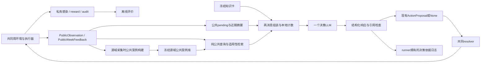

# 推荐架构与可实施接口

设计版本：`cemas-public-case-design-v1`，2026-10-17。**推荐单个无会话状态的决策LLM，配合程序生成的近期摘要、人工复核并冻结的知识卡、公共源域案例检索和确定性检查。** 每个决策通常一次LLM调用；无在线反思、记忆写手、审查LLM、角色辩论、外部工具或模拟器查询。全部新增模块均为拟实施设计，本轮只交付文档/人工示例。

## 1. 为什么选这一套

| 问题 | 组件及依据 | 采用边界 |
|---|---|---|
| 同一诊断趋势可能来自检测变化或延迟 | 程序近期摘要＋数据有效标记；公共ledger事实，H02/H03及[研究证据](01_research_evidence.md) | 描述已交付记录，不估计隐藏感染、不宣称恢复Markov性 |
| 相似案例可能动作/容量/观察口径不兼容 | 先过滤再数值检索，显示动作与公共后效、限制及反例 | 检索帮助比较适用性，不是Q值、最优动作标签或因果估计 |
| 无来源的“经验教训”会积累错误 | 数值/文本由固定模板形成；源库只读，保留矛盾 | 默认不用LLM反思；可复核描述比无因果标签的自由教训可靠，这是设计判断 |
| 长上下文不必然有效，历史回答可能固化错误 | 每周两消息重建；官方stateless语义及Lost in the Middle | 不断言当前模型必有相同退化；用本任务测试验证 |
| 决策依据难核查 | 结构化引用、备选与不确定性；程序校验ID/数值来源 | 引用有效不等于解释忠实，不输出/依赖完整思维链 |
| 多角色增加调用与冲突 | 默认单控制器，程序担任精确检查职责 | 近邻任务的多人协作收益不能直接迁移；等预算对照后才能升级 |

原始文献的实验环境与本任务不同；没有论文证明本方案在CEMAS最优。EpiWorld、EpiEvolve及Aoki等近邻使“知识＋记忆＋疫情LLM”本身不足以构成新方法。本方案的控制收益、检索门槛、短期摘要效果都是待验证假设。

## 2. 总体数据流与权限



图中的BUILD→CASE只发生在源域建库/冻结阶段；测试回合的PUB只能更新本回合近期状态，不写CASE。PRI没有通往MEM/RET/PACK的边。知识卡和案例是资料，不具有system指令权限。

```mermaid
sequenceDiagram
  participant R as Runner
  participant C as MemoryLLMController
  participant M as PublicMemory/ Retriever
  participant L as LLM
  participant E as Shared Environment
  R->>C: reset()
  R->>C: decide(O_d)
  C->>M: stage(O_d); summarize(O_d); retrieve(O_d)
  M-->>C: typed context + flags + evidence registry
  C->>L: fixed system + public user JSON
  L-->>C: decision JSON
  C-->>R: ActionProposal (or None)
  R->>R: persist call audits and evidence
  R->>E: step_proposal(proposal, fallback_reason)
  E-->>R: completed feedback F_[d,e] + private audit separately
  R->>C: observe(F_[d,e])
  C->>M: pair O_d with actual executed_action; close/update case
  Note over C,M: even at terminal tail; no extra day or LLM call
```

当前runner已经在terminated判断之前调用observe；不新增`on_resolution()`。控制器在observe才从公共feedback知道实际执行动作；提议失败也可能执行共同回退，因此仍形成公共经验。fatal且环境未推进时pending不会成为案例。

## 3. 模块接口（拟议，不改变共同Controller）

所有对象不可变；拒绝额外字段/非有限数/通用任意对象。公共字段从精确公共类型构造，不从audit全量序列化再删字段。

```python
class PublicEpisodeMemory:
    def reset(self) -> None: ...
    def stage(self, observation: PublicObservation) -> None: ...
    def accept(self, feedback: PublicWeekFeedback) -> tuple[PublicCaseRevision, ...]: ...
    def recent(self, observation: PublicObservation) -> RecentSummary: ...

def build_query(observation: PublicObservation, config: RetrievalConfig) -> CaseQuery: ...
def retrieve(query: CaseQuery, store: FrozenPublicCaseStore) -> RetrievalResult: ...
def select_knowledge(observation: PublicObservation, recent: RecentSummary,
                     retrieval: RetrievalResult, bundle: KnowledgeBundle) -> tuple[KnowledgeCard, ...]: ...
def build_memory_messages(observation: PublicObservation, public_config: PublicPromptConfig,
                          context: PublicMemoryContext) -> tuple[ChatMessage, ChatMessage]: ...
def parse_decision(text: str, registry: EvidenceRegistry,
                   required_flags: tuple[str, ...]) -> ParsedDecision: ...
def adapt_proposal(parsed: ParsedDecision) -> ActionProposal: ...
```

`MemoryLLMController`组合以上纯模块，复用现有transport/tokenizer/audit/retry；保持`reset/decide/observe/consume_failure_reason/drain_call_audits`。拟增加`drain_decision_evidence() -> tuple[DecisionEvidence,...]`默认空出口供runner写独立日志；不把DecisionRecord传进controller。`decide()`重复同day在尚无feedback时只允许同observation hash重入，不产生第二份pending；新day而pending未闭合为状态错误，停止。`observe()`重复同窗口同内容为幂等，内容不同或起点不匹配为fatal，防止静默错配。

| 模块 | 输入/状态 | 输出/失败 |
|---|---|---|
| PublicEpisodeMemory | 单个pending O、最近4条closed窗口、最多一个等待第二窗口的源案例；不接收run ID/seed | deterministic revision；非法次序停止；reset全部清空 |
| RecentBuilder | 当前O的四周及公共派生率；当前resources/action | RecentSummary；相同O输出相同；不把本地更早历史暗加进prompt |
| FrozenPublicCaseStore | 冻结SQLite只读；schema/version/hash已启动验收 | 公共案例；文件缺失/损坏/版本不符启动失败，不能临时伪装无记忆 |
| Retriever | 公共pre-state，固定config；不接收私有episode身份 | 有限有序案例+分项分数+排除原因；正常空结果允许 |
| KnowledgeSelector | 固定bundle和公开trigger | 卡片及冲突码；核心规则缺失启动失败 |
| MessageBuilder | O、程序摘要/案例/知识 | 两消息+引用注册表；按固定预算裁案例；核心输入仍超限则零调用fatal |
| Parser/EvidenceChecker | 最终文本、实际已发送的注册表和flags | 严格schema、适配提案、依据记录；结构失败走P4同消息重试 |
| Runner | 提案、公共/私有日志分支 | 先持久化调用及依据再推进；记录实际执行并关联依据，但不回灌私有日志 |

这里的“记忆”包括外部案例资料与客户端确定性状态；没有梯度更新。LLM在一次上下文中利用例子是in-context learning，不能称为权重训练或已学得最优策略。

## 4. 数据契约

公共嵌套类型沿用types.py定义与字段名；原始PublicObservation/PublicWeeklyRecord中的ActionVector为`{"values":[T,S,C,E,A]}`；派生RecentSummary和LLM输出中的动作明确使用五整数数组。所有时间为本回合model day，闭区间。单位：tests/notifications为人次，person_days为人天，比例不裁剪；数值canonical JSON，hash使用UTF-8排序key紧凑编码。私有文件hash不进入prompt。

### 4.1 PublicCase：一段执行窗口及可选后续窗口

| 字段 | 类型/来源/约束 |
|---|---|
| `case_id`, `revision` | 正整数、不编码seed/策略；staging事务以单调序号分配ID，revision从1递增，冻结保留ID。目标本地案例使用本回合从1开始的独立ID空间，不能并入global |
| `schema_version`, `public_task_sha256` | 固定版本及公共动作/观察/目标语义快照hash；不使用含隐藏参数的完整协议作为输入 |
| `pre_observation` | 原始PublicObservation；只在决定当时复制 |
| `executed_window` | feedback.week原样；包含实际action/resources/cost/诊断/validity |
| `window_days` | end-start+1，1..7，程序算 |
| `followup_window` | 下一次已闭合公共week或null；按实际后续动作记录，不能填想象的“保持原动作” |
| `status` | `closed_one|closed_two|terminal_censored`；首窗闭合即closed_one，第二窗后closed_two；到H仍无第二窗则terminal_censored |
| `available_through_day` | 最晚已交付窗口end；不代表世界日历；query不得读取目标未来 |
| `attribution` | 常量`descriptive_not_causal`；从不存`success`,`effect`,`optimal_action`,`reward` |
| `flags` | `testing_changed,capacity_changed,action_changed,followup_action_changed,partial_window,missing_baseline,conflicting_peer,truncated_followup`子集，程序规则生成。无完整7日后窗即truncated_followup，含无后窗及短尾窗；closed_two只表示有两个窗口，不保证14日 |
| `description` | 固定模板：“在公开状态…实际执行…持续n日；随后交付D，实际检测T，通知L，并集Q，活动A；后窗…；这些是关联记录，非因果估计。” |
| `public_source` | `{kind:"source_simulation",observation_sha256,feedback_sha256,followup_sha256:null|str}`；hash仅公共内容 |

`window_days=7`案例用于默认长期检索；尾段仍存档但默认排除，避免把2日结果与周结果直接比较。所有案例保留实际成本分项，允许零、超过参考量，不按“表现漂亮”筛掉。私有构建索引另存`case_id -> collection trajectory/seed/policy/source code/calibration/split`，只给建库器/审计，不与公共SQLite同连接暴露。公共侧不能由ID反查私有元数据。

源案例后效两窗口最多14日，是帮助看滞后与后续动作的**设计观察长度**，不是疾病最大延迟。即使相同动作持续14日也不能确认因果；未交付事件永远不补填。源库所有公共后效是已结束源域经历，允许在测试时检索；目标自己的未来反馈不可用。

### 4.2 RecentSummary

字段固定：`decision_day:int, valid_week_count:0..4, windows:[{start_day,end_day,diagnoses,tests,notifications,union_person_days,activity_person_days,executed_action,resources,growth,growth_valid,proxy,proxy_valid}], current_action:[5], action_duration_days:[5], capacity_changed:bool, testing_changed:bool, trend_direction:up|down|flat|insufficient, flags:str[]`。

windows只来自O的有效history，按旧→新。activity为三类限制人天之和；trend取最后两个有效完整周D差的符号（差0为flat，少2周为insufficient），不能说感染趋势。testing_changed阈值见04章，capacity_changed对比当前资源与最近周。每条数值可定位回O，摘要只是展示/算术辅助，不增加观测；`none/global`消融使用`recent:null`，但保留相同原始四周O，故短期消融测试的是表征/显式整理增益，并非“有历史对无历史”。

### 4.3 Query、RetrievalResult及上下文

```text
CaseQuery = {schema_version, public_task_sha256, state:float[], state_valid:bool[],
             trend:float[][], trend_valid:bool[][], resources:PublicResources,
             legal_action_mask:bool[324], remaining_fraction:float}
RetrievalResult = {status:ok|empty|out_of_support|unavailable,
  items:[{case:PublicCase, state_rms:float, state_score:float, trend_score:float|null,
          final_score:float, applicability_codes:str[]}],
  flags:str[], excluded_counts:{reason:int}, configuration_version:str}
PublicMemoryContext = {mode:none|short|global|both, recent:RecentSummary|null,
  knowledge:KnowledgeCard[], retrieval:RetrievalResult}
```

store版本/hash及全候选诊断仅供runner依据日志；prompt只显示必要的状态/得分/限制、所选案例和配置版本，不暴露集合里的隐藏采集标签。`none/short`检索status为empty、items空，但不能把禁用误报为失败；另有`retrieval.flags=["disabled"]`。所有模式使用同一system与输出schema，只有memory内容变化。

### 4.4 决策响应与依据记录

新wire恰好5个字段：

```json
{"action":[1,2,1,0,0],"reason":"仅示例；比较公共趋势、执行量与负担后选择合法档位。","evidence_ids":["O:/resources/screening_daily_capacity"],"alternative_actions":[{"action":[1,1,1,0,0],"tradeoff":"降低检测负担，但公共观察更少。","evidence_ids":["K:SIM-04"]}],"uncertainty_codes":["partial_observability"]}
```

`action`沿用普通整数五维范围；`reason`单行1..120字符；evidence_ids唯一1..8项；alternatives允许0..2（无历史/无适用案例可0），每项action不同于选中、tradeoff单行1..80字、引用1..4；uncertainty_codes唯一1..8且包含程序required_flags。枚举为`partial_observability,no_history,testing_changed,capacity_changed,no_case,case_conflict,out_of_support,truncated_followup`。所有模式强制partial_observability；无有效周强制no_history；testing/capacity根据当前O而非memory开关强制；启用global且最终发送案例为空（含预算裁空）强制no_case；已发送案例有冲突/截短后窗分别强制case_conflict/truncated_followup；retrieval为out_of_support时强制同名码。所有候选都仅为比较，不限制LLM只能选检索动作。新schema检查动作类型/范围；主动作资源非法仍交共同resolver，备选资源非法只在依据日志标infeasible、不执行，也不因此拒绝主动作。

引用语法：`O:<JSON pointer relative to observation>`只指存在且有效的公共叶/对象（无效history位置禁止）；`R:<RecentSummary field>`仅recent存在时；`K:<card_id>`仅本次发送卡；`C:<positive case_id>`仅本次发送案例。`O:/history/3/delivered_diagnoses`即最近周数值；知识固定六条也注册K:SIM-01..06。程序不接受URL、自造ID、未发送/已裁剪案例。新schema不让LLM改写数值，数值证据由注册表原值自动输出到依据日志。

`DecisionEvidence`为runner-owned artifact：`schema_version,decision_day,observation_hash,context_hash,template_hash,knowledge_bundle_hash,case_store_hash,retrieval_config_hash,request_action,reason,cited_evidence:[{id,source_pointer,value,unit}],alternative_actions,uncertainty_codes,program_flags,structural_checks,semantic_review_status,selected_case_ids,dropped_case_ids,retrieval_status,attempt_count`。解析失败也保存失败类别/原文于现有调用日志，不伪造有效依据。runner执行后关联`executed_action, adjustment_reason, fallback_reason`；这些不回传memory。`semantic_review_status="not_reviewed"`默认，不能叫“已验证忠实解释”。

引用/范围/所引数值可机械复算；理由是否逻辑充分、是否过度因果化、是否遗漏权衡需离线盲评或证据扰动实验。单靠自由文本regex或第二个LLM不能保证忠实。发现内容问题不更改已经发生的轨迹；记录违反率，严重问题在源域修订模板后另起版本。在线结构性错误重试；资源非法仍交共同resolver，不能新增LLM专属动作投影。

## 5. 记忆生命周期及持久化

1. reset清pending、近期窗口、反馈去重表；global store始终只读。冻结文件启动验schema/hash/公共任务兼容性，含未审核卡片或不兼容案例拒绝启动。
2. decide(d)暂存精确O_d；这是未完成记录，无动作后效，不可检索。调用失败耗尽也保留pending，因为环境会合法回退并真实执行。
3. observe(F_[d,e])检查start=d、end=min(d+6,H-1)、天数和资源字段；以F.week.executed_action创建第一窗。切勿使用LLM请求动作代替执行动作。
4. 同次observe可为上一案例补充followup_window。若下一周换档/容量变化，完整保留并标flag；不把混合政策后效归给第一动作。修改创建新revision，不就地改旧值。
5. e=H-1时将新案例标terminal_censored（没有后窗），前案例如取得第二窗则closed_two；尾窗partial_window；不调用模型、不推进额外日、不提前交付pending事件。
6. 源域采集：每次公共revision原子写staging JSONL/SQLite事务，失败使采集run失败并保留已写证据；不静默丢样本。目标测试：案例仅本回合内存/单独公共审计输出，不进入可检索global。
7. 构建审核：去除格式/时间/权限无效样本，保留低诊断、高诊断、高负担及互相矛盾的有效记录。冻结manifest为每case固定唯一最新有效revision，旧revision只供审计，不重复检索。内部安全索引表`case_group(case_id INTEGER PRIMARY KEY, opaque_group TEXT NOT NULL)`仅用于同源轨迹去重；opaque_group为构建器随机分配的无语义标识，不能解码seed/策略、也不进prompt。私有manifest另保留真实来源映射，运行时store没有其连接。冻结manifest含数据hash、排序、feature尺度、来源划分和审核计数；只读SQLite `mode=ro`，测试不挂staging写连接。
8. 错误更正/新源数据生成新库版本；旧版保留溯源；不删除反例、不覆盖旧实验输入。目标测试结果绝不调检索/知识/阈值。

不在本轮引入“反思”。本任务没有每次动作的正确答案或公共真实奖励；措辞更像教训不代表可用知识。若未来验证自由反思确有收益，先在源域做“确定性描述 vs LLM总结 vs 额外决策计算”对照，并限制只能生成带来源的假设，不能写因果/最优标签；该实验不在主方案调用图中。

## 6. 案例采集与具体检索算法

### 6.1 对27×4的判断

保留27世界×4策略作为初始开发规模，H112最多1728首窗，不声称够学324动作。最低/最高轨迹覆盖两个边端，uniform补组合，tuned_threshold补适应轨迹；threshold尚未实现且需在A/B选择后再冻结建库。四条同世界轨迹相关，不能当108独立世界。先留一世界/容量评估，再决定扩库；不按测试收益扩库。

必须登记：每维level、合法S/容量、联合动作、转移动作、动作持续天数、测试量变化、增长方向/无效、不同剩余时域、学校/工作比例、样本有效率及每query可用动作多样性。稀疏网格作为局限；每维覆盖通过不等于每组合/反事实覆盖。新采集优先由源域合法随机策略增加未覆盖的动作转换与资源条件；若增加受控持有期或资源事件，属于collection policy/scenario版本变更、私有manifest披露，并给全部依赖源经验的方法同一数据预算。不得从目标城市/最终E4回填。

成功/失败不使用私有感染或reward标签。可检索记录仅显示`公共诊断上/下/不变、检测上/下、负担分项`；离线评价可私有分析哪类案例来自表现差的策略，但不据此筛选、排序或在prompt标红绿。相似前态不同后效必须保留。

### 6.2 主检索参数（替代旧P5候选）

默认**无embedding**。小型结构数据优先固定尺度数值检索，去除旧文本权重1/3和模型下载依赖；语义相似度只作为验证扩展。保留top_k=6上限、同执行组合最多2、短期4周。旧`.4/.2667/.3333`留作公平检索对照，不能未经新版本就混用。

查询只用pre_observation。state向量按固定次序：最近有效周`D/N, tests/(7N), notifications/(7N), isolation/(7N), quarantine/(7N), union/(7N), school_activity/(7Ns), work_activity/(7Nw), community_activity/(7N), growth`；再接`clinical_cap/N,screen_cap/N,tracing_cap/N,remaining/H,Ns/N,Nw/N,Nsw/N`、五年龄比例、16位current_action one-hot。尺度分别为`.01,.12,.10,.02,.05,.05,1,1,1,1,.02,.10,.01,1,1,1,1,1×5,1×16`。无有效最近周的前10维无效（growth另查growth_valid，Ns/Nw为0则对应活动无效）；当前字段有效。day0查询只匹配源day0；有历史query排除无历史案例。

趋势向量保存最近3个完整有效周每周`D/N,tests/(7N),notifications/(7N),union/(7N),total_activity/(7N)`的原始一阶差，不预归一化；不足2周趋势不可用。右对齐可比较差分行，仅双方有效单元参与；不使用Pearson常数序列特判。对有效交集求`rms=sqrt(mean(((x-y)/scale)^2))`、`sim=exp(-rms)`，趋势scale为`.01,.12,.10,.05,1`，仅在RMS处除一次。state有效交集占union有效维不足0.75时排除；数值不clip。

硬过滤：schema/public_task版本不符、非source库、审核不通过、首窗非7日、query时case执行动作不满足query mask、容量与首窗资源的各比率绝对差分别超过`.01,.03,.005`均排除（clinical/screening/tracing；“分别”表示任一超阈值即排除）。当前S3不可执行的案例不拿S3表现推荐S2；可在研究审计计数但不注入。人口结构只按上述公共比例比较，不读隐藏场景标签。

排序：`score=.75*state_sim+.25*trend_sim`；trend不可用时只用state_sim并标`trend_missing`。state_rms>3或score<.35不入选；阈值为源域待校准默认，不是外部理论保证。初筛前24按score降序、case_id升序。贪心选择：首例最高分；之后最大化`score - .10*max(selected,state_similarity)`，并限制同action≤2、同源轨迹≤1、同公共内容hash≤1。同轨迹约束由store内部opaque grouping执行，不把group映射seed交模型；不足6不补低质例。首轮尽可能选不同action：若候选有其它action且尚不足2种则下一例限定不同action；不为凑多样性突破过滤。

证据冲突：合格pool前24中，两个相同executed_action、两案例前态之间pairwise state_sim≥.8、首窗相对各自pre最近周诊断变化符号相反且各自绝对变化≥5，则构成冲突候选对。先按两者query_score最小值降序、排序后的case_id二元组升序选第一对；同轨迹/同内容对排除。若存在，先锁这两例，再按上述贪心补其它动作到6；冲突对优先于“首个最高/第二个不同动作”，没有冲突对才执行原首选规则。最终发送仍含该对才标`case_conflict`；仅称公共结果异质，不称策略矛盾。正负变化阈值只识别提醒，不用于策略奖励排序。

`out_of_support`：无候选通过state_rms/score门槛但有结构兼容候选；结构过滤后无候选为empty。返回empty/out_of_support均允许常规LLM决策，不自动改成强干预或固定hold；必须传no_case及相应不确定性。一次运行时只读查询IO故障捕获已知IO异常，返回unavailable并记录；继续当周无案例，随后仍重试读库，不静默永久切模式；库hash改变/损坏为fatal。旧embedding对照若向量不可用，预注册numeric降级并记录该批，主方案不存在此故障依赖。

### 6.3 案例如何影响选档

LLM先看当前公共证据与负担，再比较案例的前态、执行动作、资源、持续时间及后续动作；明确当前有何不同，不把最高相似案例当命令。它可选未检索动作，引用公共规则/观察并承认无直接案例支持；不得据源案例估算未观测感染下降百分比。案例提供`情景对应、可执行性、测量变化提醒、控制/负担权衡示例`，没有监督标签证明“正确档位”。是否真帮助选档由盲化成对闭环实验与删/换案例扰动检验。

## 7. 调用、预算和失败语义

实际LLM调用清单只有`decision`：每周system/user，一次成功；最多3attempt、2/4秒等待、同消息重试、SDK retry0、timeout120，复用P4fatal类别。输入cap131072、总output cap65536继承当前协议，新增紧凑响应不是实际token节约证明。常规工程目标输入≤16384（软目标，不是新硬上限）；先最多6案例、3外部卡和4周摘要。

完整输入超131072时依次删最低排名案例（整条，冲突对作为整体删）、低优先级外部卡、recent摘要（原O保留），每次官方计数并登记dropped；裁剪后重建registry与required_flags。始终保留公共O、mask、全部动作/目标/核心六条/输出规范。仍超限零调用fatal。正式比较必须报告裁剪率，不能悄悄把both称full memory而不说明无案例。输出截断或解析/引用失败同消息重试，不增加修复/审查调用。穷尽返回None和llm_retry_exhausted；shared resolver保持当前合法组合，必要时只降低当前S。资源非法提案依现有resolver回退整个当前动作，不能对请求仅修S。

### 7.1 明确的变更清单与公平性

| 项目 | 是否改任务 | 未来实施所需变更 |
|---|---|---|
| 公共观察/反馈、324动作、7日、奖励/信息来源 | 不改 | 沿用现有类型/runner反馈；无sim工具 |
| 短期摘要＋冻结公共源库 | 控制器内部能力扩展 | 新memory/retrieval模块；长期库来源在原计划内；相同公共历史可供所有方法留存，比较披露源经验预算 |
| 五字段LLM响应、依据日志 | 改LLM wire契约，不改ActionProposal/执行语义 | 新prompt/parser版本及配置；旧P4两字段parser原样保留基线；所有新memory消融用同一五字段schema |
| 数值检索/阈值/新特征 | 改原P5推荐参数 | 新检索config版本，源域验证；不修改现有JSON后直接宣称v1协议兼容 |
| 运行目的/冻结门禁 | 扩展现有仅prompt-development限制 | 后续阶段给memory_collection/正式测试显式入口与只读库验收；不能绕过P4 runner限制 |
| 已存在E0和provider门禁 | 不取消 | 先修复环境/重建兼容E0、官方tokenizer及真实三case验收后再做实验 |

建议单controller+审查器、3角色协调、累积对话、LLM反思均为验证替代，不进入主系统。其完整主方案提示词因而只有一个模板；无需为未采用组件造空实现。03章规定等预算对照与升级条件。
