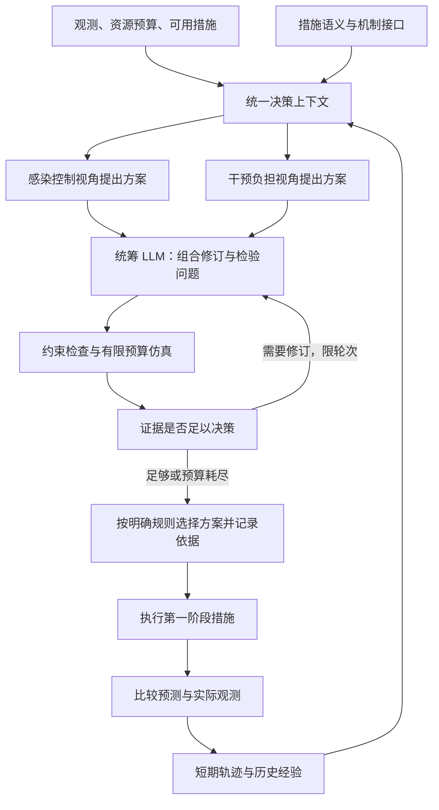
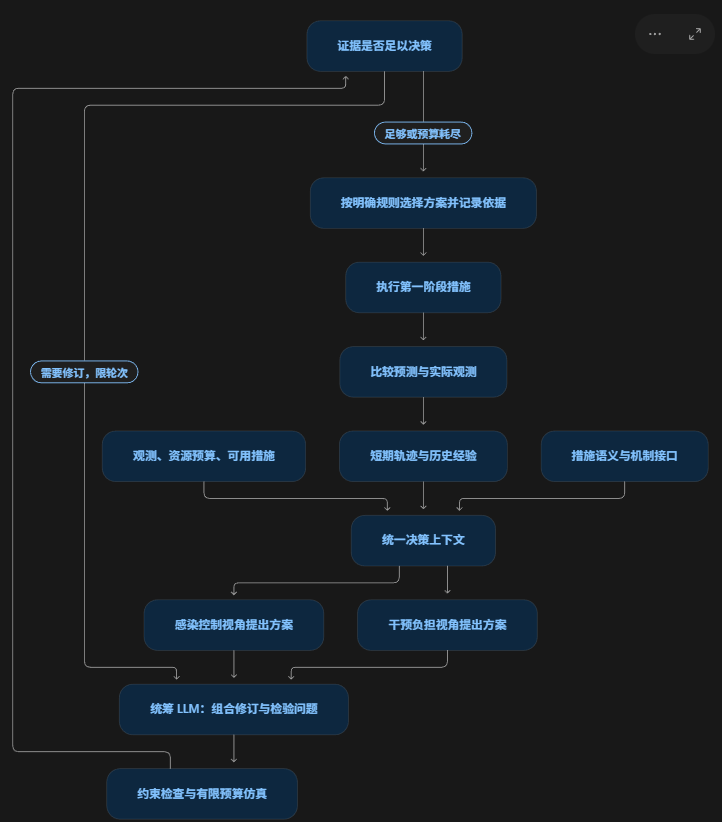

我建议把现有的 **“状态与记忆 → LLM 选择策略”**，升级成一套 **“理解措施 → 生成组合方案 → 仿真检验 → 选择并执行 → 用反馈修正经验”** 的控制架构。

你的两个想法分别嵌入其中：**理解通道提供措施语义和证据，多种决策倾向拓展候选方案。** 我补充的核心是：让智能体主动选择需要检验的问题，并根据预测与实际反馈的差异调整后续决策。

整套模块可以由 **一个统筹 LLM、两个方案生成角色，以及程序实现的记忆、仿真和验证工具**组成。同一个基础模型即可承担这三个角色，首版不需要再增加独立的裁判、解释或记忆智能体。

**一、先建立统一的措施语义接口，这是“理解通道”的基础。**

LLM 需要理解每项措施实际做什么，以及哪些组合能够执行。建议每项措施使用统一描述：

| 内容 | 示例 |
|---|---|
| 可控动作 | 筛查频率、检测资源分配、场所限制等级 |
| 作用对象 | 学生、教职工、工作场所、公共活动 |
| 模型中的作用路径 | 提高发现概率、缩短发现延迟、减少某类接触 |
| 资源要求 | 检测名额、追踪人员、实施时间 |
| 延迟与依赖 | 效果何时可观察，是否需要检测或追踪配合 |
| 适用条件 | 当前是否开放、最低持续时间、与其他措施的冲突 |
| 依据来源 | 对应的仿真实现、配置版本和模型假设 |

这些事实应来自代码与研究者确认的模型定义。LLM 可以解释和组合它们，不能自行编造措施效果。

首版不必让 LLM 自动阅读整个模拟器并生成大型机制图。先把现有干预实现整理成准确的结构化接口，足以支撑组合决策，也更容易验证。

新措施中途出现时，通过这个接口注册其动作、条件和资源要求，控制器便能将它纳入候选组合。校园和城市则共享控制接口，由场景适配层提供不同的接触结构和措施含义。

这部分借鉴 MechSim 的结构化机制表示；你的方法重点应进一步落在连续控制中的方案生成和反馈修正。[MechSim 原论文](https://arxiv.org/html/2606.04505v1)

**二、保留双分支记忆，但让记忆表达“经验是否适用”。**

现有短期轨迹和长期检索可以继续使用，需要补充两类信息。

短期记忆记录：

- 当前措施实施多久，效果是否已经进入可观察窗口。
- 最近预测了什么，后续实际观察到了什么。
- 哪些判断得到支持，哪些判断仍未确定或已失效。

长期经验除疫情状态外，还应包含当时的资源、可用措施、接触结构、报告延迟和实际执行的组合。

检索首先检查适用条件，再比较状态相似性。例如，同样的病例增长，在检测能力充足和检测能力骤减时，过去的应对方案未必同样适用。动作拆分后，也应按措施的组成和作用路径检索，不能继续主要依赖 P0–P4 的等级相似性。

**仿真预测与执行经验必须分开保存。** 尚未执行的候选方案只有预测证据，不能作为“成功实施过”的经验进入长期库。评估期间，离线经验库保持冻结，当前运行的反馈进入自己的短期记忆。

**三、两个角色共同生成方案，使用同一个任务目标。**

我保留你提出的不同决策倾向，但将它们用于寻找不同的解，而不是分别决定最终目标。

| 角色 | 职责 | 输出 |
|---|---|---|
| 感染控制视角 | 寻找控制效果较强的措施组合 | 候选计划、作用假设、可能代价 |
| 干预负担视角 | 寻找负担较低的替代组合 | 候选计划、节省的资源、可能增加的风险 |
| 统筹 LLM | 合并候选、识别关键分歧、修订组合、提出检验任务 | 精简候选集、需要验证的问题 |

所有角色遵守同一份任务规格，例如：

> 在规定的检测资源和场所限制上限内，尽量降低感染负担。

“负担视角”不能为了减少限制而忽略感染目标；“感染视角”也不能无视资源上限。它们的区别体现在搜索方向。

候选应是未来两到三个决策周期的短计划，最终只执行第一周期，再根据新观测重新规划。每个视角初始提交一到两个方案，加上当前仍可执行的方案即可，先控制候选数量。

这里 LLM 的作用是**根据场景和措施语义，提出有竞争力的组合**。是否比数值搜索更高效，是后续需要证明的能力。

**四、统筹 LLM 将方案分歧转成具体的仿真问题。**

它不只是询问“哪个方案最好”，而应识别真正影响选择的未知量。例如：

- 提高筛查能否替代进一步限制课堂接触？
- 一个组合中的追踪措施是否仍有额外收益？
- 检测能力降低后，过去有效的组合是否依然可行？
- 当前病例上涨是否可能来自检测变化和报告延迟？

每个问题都应指定比较方案、观察指标、时间窗口和关键假设。程序先处理可以直接确定的问题，再分配仿真预算。

两类约束必须区分：

| 类型 | 如何检查 |
|---|---|
| 动作范围、措施是否开放、资源分配、最短持续时间 | 执行前直接检查 |
| 未来感染峰值、实际隔离人天等结果 | 依据预测范围检查，并在执行后验证 |

后者依赖模型，不能宣称得到严格保证。

仿真工具基于当前可获得的观测和参数估计，运行多个合理情景，返回结果范围及配置编号。主要实验中应避免让预测工具直接读取评估环境的真实隐状态或未来事件。

**五、仿真预算优先用于可能改变决策的问题。**

这是我建议加入的一个实质能力点。

如果两个方案的结果已经明显分开，就没有必要不断重复仿真。若排序取决于检测效果、报告延迟或某项预算是否超限，就优先细化相应问题。

首版可以采用简单规则：

- 先给每个候选相同的少量仿真预算。
- 优先补跑结果接近、约束接近边界或跨情景排序不一致的候选。
- 允许统筹 LLM 根据证据修订一轮方案。
- 达到预算上限后，使用当前证据决策，并记录剩余不确定性。

不必一开始就建立复杂的信息价值模型。先证明这套分配方式比均匀或随机分配更有效。

**六、最终取舍使用公开规则，解释直接来自决策记录。**

程序负责检查可行性、比较数值结果，并按既定目标选出方案。统筹 LLM 可以依据检验结果修订候选，也负责将最终依据表达清楚。

决策输出应包含：

| 输出 | 内容 |
|---|---|
| 执行动作 | 本周期具体措施组合与资源分配 |
| 选择依据 | 哪些仿真比较和约束支持该方案 |
| 替代方案 | 为什么没有选择主要备选 |
| 预测承诺 | 在什么时间窗口内，哪些可观察指标预计如何变化 |
| 失效条件 | 哪些新情况会促使重新检验或调整 |

解释因此贯穿方案提出、验证和修订过程。它提供可追溯的决策依据，但不能据此宣称揭示了 LLM 全部内部推理。

若执行层调整了提案，记录和解释必须对应**最终实际执行的动作**。

**七、执行反馈修正记忆，完成下一次决策的闭环。**

每个周期比较预测与实际可观察指标，包括诊断、检测、阳性率及干预负担。连续偏差可以触发：

1. 降低相关经验的适用权重。
2. 重新检验影响方案排序的假设。
3. 在后续规划中增加对相关不确定性的考虑。

需要考虑干预和报告延迟，避免把一次短期上涨直接判为失败。若后续实际动作与原计划不同，也要调整比较口径，不能把未执行原计划造成的差异归为预测错误。

这样，记忆保存的是“条件—行动—预测—观测—修正”，比单纯保存策略和结果更能服务于适应。

**整套架构的核心贡献应集中在三个连接点。**

| 连接点 | 能力增益 | 必要验证 |
|---|---|---|
| 措施语义连接组合规划 | 面对不同场景或新措施，生成有效、可执行的组合 | 与同预算数值候选搜索比较，并移除机制信息 |
| 候选分歧连接仿真检验 | 用有限计算解决影响决策的关键问题 | 与均匀、随机分配仿真预算比较 |
| 预测承诺连接经验修正 | 环境变化后减少过时经验的影响 | 移除预测偏差检测与经验降权，比较恢复表现 |

不同视角角色还需与**同角色重复采样**比较，并控制 token 和仿真预算，才能判断收益来自职责差异还是额外计算。

这套系统在数学上仍属于仿真支持的滚动规划。与 MPC 的区别，需要由**组合生成效率、变化后的适应能力和计算成本**证明；解释文本本身不能承担这个证明。

首版就按上述闭环实现，保留现有双分支记忆、执行干预和审计日志，集中新增措施语义接口、候选计划、有限仿真检验及预测反馈记录。先在校园跑通完整周期，再用城市和中途变化实验检验同一架构。