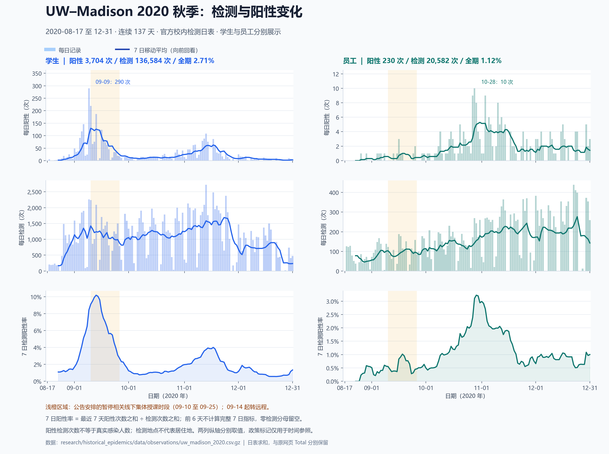

# UW–Madison 2020 本地数据概览

图表依据本地归档重新计算；2026-10-22另补归档EID研究及观测审计说明，详见[审计边界](../../sources/evidence/uw_madison_2020_observation_audit.md)。这里的 UW2020 指威斯康星大学麦迪逊分校 2020 年秋季。

## 数据总览

| 内容 | 当前本地覆盖 | 文件入口与含义 |
|---|---|---|
| 2020 官方每日校内检测 | 2020-08-17—12-31；137 日、548 条观测 | [uw_madison_2020.csv.gz](../../data/observations/uw_madison_2020.csv.gz)；学生/员工 × 每日阳性/检测量 |
| 2021 春官方回溯快照 | 2020-08-07—2021-05-09；276 日、1,656 条，其中 2020 年 882 条 | [uw_madison_2021_spring.csv.gz](../../data/observations/uw_madison_2021_spring.csv.gz)；学生/员工校内阳性、校内检测量、校外阳性，共 6 个序列 |
| Big Ten 汇编中的 UW 片段 | 2020-08-07—12-19；135 个日期、270 条观测 | [bigten_raw.csv.gz](../../data/observations/bigten_raw.csv.gz) 中筛选 `entity_id=university_uw_madison`；累计报告病例、累计检测次数，各 135 条 |
| 结构化政策事件 | UW 相关 11 条（包括日期未知的制度背景） | [events.csv.gz](../../data/events.csv.gz)；由 [manual_context.json](../../sources/manual_context.json) 维护 |
| 结构化人口记录 | UW 相关 7 条，含不同学期、不同口径及入住周队列 | [populations.csv.gz](../../data/populations.csv.gz)；同上 |
| 原始归档与出处 | 两份仪表板网页、一份研究网页、一份人口 PDF及下载清单 | [2020 HTML](../../data/raw/uw_madison_2020.html)、[2021 春 HTML](../../data/raw/uw_madison_2021_spring.html)、[人口 PDF](../../data/raw/uw_madison_population.pdf)、[下载清单](../../data/download_manifest.json) |
| 研究文档补充 | 人口、住宿与岗位证据及限制 | [人口与参数核查报告](../uw_madison_2020_replacement_parameters.md)；文档中的补充数字不等于已经进入结构化人口表 |

这三份观测文件包含相互重叠的同校记录，行数不能相加解释为独立观测日或独立疫情。2020 日表的 548 条与春季快照重叠的同口径 548 条逐值一致。Big Ten 为第三方汇编，保留其累计值，不对累计序列求和，也不自动差分为日新增。

## 2020 核心日表

548 条 = 137 天 × 2 人群 × 2 指标；每行有 16 个字段。

- 人群：`students`、`employees`。学生雇员和研究生雇员归学生。
- 范围：全部为 `on_campus_testing`。检测地点不代表居住地。
- 指标：`new_positive_tests`、`new_tests`，单位为检测次数。阳性检测不直接等同于真实感染或去重诊断人数。
- 日期：`date_start`、`date_end`、`time_basis`、`frequency`；当前日期口径标记为 `dashboard_date`，不擅自改作采样日。
- 其余字段保留数据集、机构、质量、来源 URL、原始单元格定位和原始字符串。
- 阳性率由阳性次数除以检测次数计算；不是以注册人口为分母的感染率。原网页单元格中的括号百分比也保存在 `raw_value` 中。

| 人群 | 日表阳性次数合计 | 日表检测次数合计 | 全期检测阳性率 |
|---|---:|---:|---:|
| 学生 | 3,704 | 136,584 | 2.71% |
| 员工 | 230 | 20,582 | 1.12% |
| 两组合计 | 3,934 | 157,166 | 2.50% |

这些合计只覆盖 137 个已列出日期；不是去重受检人数。

| 日期 | 学生阳性 | 学生检测 | 员工阳性 | 员工检测 |
|---|---:|---:|---:|---:|
| 2020-08-17 | 0 | 0 | 0 | 1 |
| 2020-09-02 | 34 | 906 | 0 | 93 |
| 2020-09-09 | 290 | 2,264 | 0 | 138 |
| 2020-09-10 | 219 | 2,238 | 0 | 122 |
| 2020-09-14 | 2 | 25 | 0 | 2 |
| 2020-11-12 | 88 | 2,090 | 6 | 329 |
| 2020-12-31 | 5 | 474 | 3 | 259 |

## 可视化与导出



左列为学生，右列为员工；两列分别取纵轴范围。浅色柱为每日记录，实线为最近 7 天移动平均；底行是最近 7 天阳性次数之和除以检测次数之和。前 6 天不计算完整 7 日指标，检测量为零时阳性率留空。浅橙区域仅标记公告安排的相关线下授课暂停时段，不代表政策效果估计。

- [完整日表 daily.csv](daily.csv)：137 行，含原始计数、每日阳性率和 7 日指标，UTF-8 BOM，可用 Excel 打开。
- [按月与人群汇总 monthly.csv](monthly.csv)：10 行，8 月仅含 17—31 日，不补齐缺失月初。
- [PNG 图片](overview.png)、[SVG 矢量图](overview.svg)。

| 月份 | 学生阳性 / 检测 | 学生阳性率 | 员工阳性 / 检测 | 员工阳性率 |
|---|---:|---:|---:|---:|
| 8 月 17—31 日 | 109 / 8,065 | 1.35% | 2 / 909 | 0.22% |
| 9 月 | 1,931 / 33,606 | 5.75% | 16 / 2,963 | 0.54% |
| 10 月 | 441 / 36,414 | 1.21% | 77 / 4,392 | 1.75% |
| 11 月 | 1,020 / 38,411 | 2.66% | 78 / 5,681 | 1.37% |
| 12 月 | 203 / 20,088 | 1.01% | 57 / 6,637 | 0.86% |

学生日阳性最高为 9 月 9 日 290 次；员工日阳性最高为 10 月 28 日 10 次。这是检测观测峰值，不能直接称为真实感染峰值；检测量和受检者选择会影响曲线。

## 人口与政策背景

结构化人口表保存注册学生 45,540、本科生 31,650、研究生/特殊学生/专业学位学生合计 13,890、Fact Sheet 教职员工 23,917，以及 2021 春 dashboard 员工分母 19,225。前三者为总数及其子组，不能重复相加；后两个员工数来自不同口径，不能互换或相加，也不能默认与学生完全互斥。

[补充报告](../uw_madison_2020_replacement_parameters.md)还整理了计划住校 6,500 人、研究宿舍住户队列 6,162 人、19 栋宿舍，以及岗位分类。这些来自不同时间点和来源：计划数不等于实际入住数，宿舍研究队列不等于全校学生，岗位数不等于去重自然人数。进一步细分的部分人口证据尚未取得原件，不能与已归档人口 PDF 同等使用。

UW结构化事件现有11条；其中原先的3条接触政策均来自9月9日公告：

| 生效日期 | 事件 | 范围与结束日限制 |
|---|---|---|
| 2020-09-09 22:00 | Sellery、Witte 两座宿舍住户原地检疫 | 针对两座宿舍，不是全校；实际解除日未核实 |
| 2020-09-10 | 暂停相关线下集体授课 | 公告安排至 9 月 25 日，临床训练例外；不能仅据公告认定实际恢复日 |
| 2020-09-14 | 相关课程转为远程 | 至少两周，未自动推算确定结束日 |

2020 原始网页另有 9 条 `Notable events` 背景记录，涵盖 8 月 6 日检测启动、8 月 25 日增设检测点、8 月 25—31 日入住、9 月 2 日开学、9 月 7 日限制本科生活动、9 月 9 日停课公告、9 月 26 日部分线下活动恢复、10 月 6 日新增检测点、11 月 30 日转全远程教学。其中检测点启动/扩展及研究描述的入住筛查/复检、网页统计修订已补入结构化事件表，详细范围见[观测审计说明](../../sources/evidence/uw_madison_2020_observation_audit.md)。

入住周研究还报告5,820/6,162名宿舍学生受检（94.4%），已保存两条区间/队列记录；这不是全校逐日或全期去重受检人数。全校受检者的症状、住宿和检测路径构成仍缺失，不能用检测次数推算受检覆盖率，图中阳性率也不能当总体感染率。

## 保留的口径差异与数据缺口

原始网页 `Total` 与可读取日行求和不同，分别保留：

| 人群 | 日行求和：阳性 / 检测 | 网页 Total：阳性 / 检测 | Total 减日行：阳性 / 检测 |
|---|---:|---:|---:|
| 学生 | 3,704 / 136,584 | 3,711 / 136,826 | 7 / 242 |
| 员工 | 230 / 20,582 | 233 / 21,025 | 3 / 443 |

页面注明校内检测 8 月 6 日已开始，但 2020 日表从 8 月 17 日起；差额的具体原因未由本次证据确认，没有补数或调平。

2020 网页摘要另列校内外合计阳性 5,414（学生 4,851、员工 563），按检测地点为校内 3,944、校外 1,470。它们是页面累计摘要，不能替代 137 日日表。2020 核心规范化表不含校外逐日序列；春季回溯快照提供校外逐日阳性，但无对应校外总检测量，因此不能计算校外阳性率。

本地 UW 观测表未提供个体病例、逐日真实感染人数、住院/死亡/ICU 日序列、年龄/性别病例分层、每日实际到校人数或实测接触网络。人口与住宿背景也不是这些缺失序列的替代值。

## 复现与检查

从仓库根目录运行：

```powershell
& 'E:\pytroch\anaconda3\envs\simulation\python.exe' research/historical_epidemics/reports/uw_madison_2020_overview/generate.py
```

生成时验证三份相关观测文件与目录 SHA-256 一致、UW 三个原始归档与下载清单哈希一致；重新解析 2020 HTML，逐条核对全部 548 条观测及来源字段；检查日期连续、组合唯一、质量标记、阳性不超过检测量和跨快照重叠一致性；回读 137 行 CSV 核对计数合计及零分母/不足 7 日的空值处理。图像已经人工查看。
